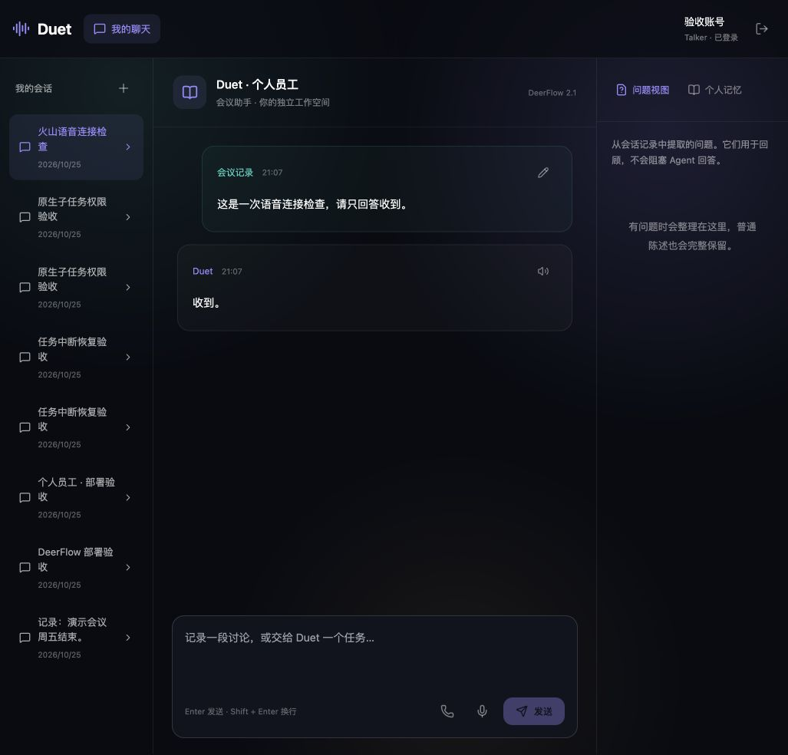
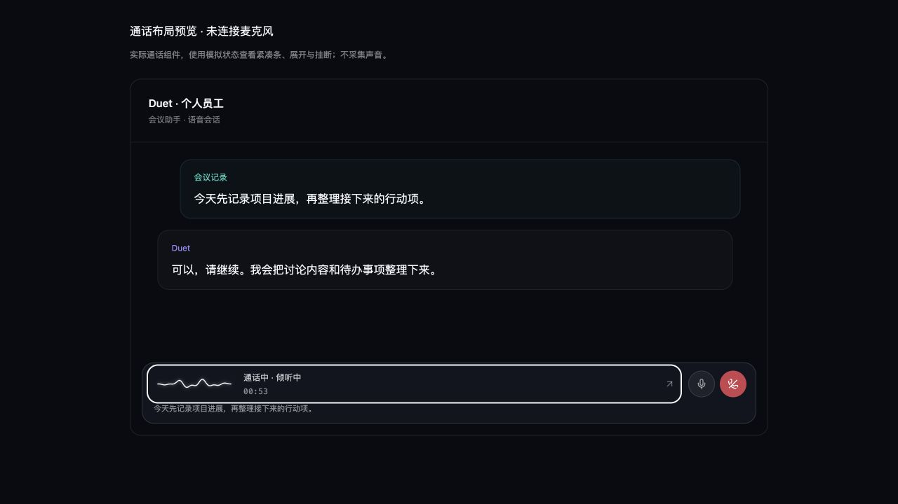

# Duet · 个人员工

**把对话留下，让事情向前。** Duet 是一个面向个人工作空间的会议助手。它基于 DeerFlow 2.1，支持保存会议记录、整理问题、执行后续任务，并在多个会话间延续个人记忆。

> 本仓库采用 [Personal Study License 1.0](LICENSE)，仅供个人学习和私下实验。它是源码可见项目，不是 OSI 定义的开源软件；禁止商用、盈利性运营及对外提供服务。第三方组件按各自许可证授权，详见 [第三方说明](THIRD_PARTY_NOTICES.md)。

## 界面预览

<p align="center">
  
  
</p>

| 工作空间 | 连续语音 |
| --- | --- |
| 保存会议内容，与 Duet 在同一会话中继续处理；问题视图帮助回顾对话重点。 | 语音通话界面预览展示实时状态与转写；截图使用模拟状态，不采集麦克风。 |

## 功能

- **记录即任务**：输入问题、会议记录或普通陈述；每条内容都会先保存，再进入独立 Run。
- **个人记忆**：跨会话检索个人记忆；只有实际保存成功后，助手才会确认记住内容。
- **语音交互**：支持语音转写确认和连续通话；挂断、停止播放与停止任务彼此独立。
- **问题回顾**：从会话记录提取问题作为展示视图，不会阻塞原始任务。
- **工作空间隔离**：账号、会话、Run、checkpoint 和文件访问都按服务器端会话与归属校验。
- **Hinter 管理**：管理员可授权 Hinter 管理员，通过目录维护公开提示和私有备注；私有备注不会进入用户或 Agent 上下文。

## 快速开始

### 环境要求

- Docker Desktop 或 Docker Engine，支持 Docker Compose v2
- 首次构建至少 **8 GB 可用磁盘空间**
- 可访问容器镜像和模型服务所需的网络

### 启动

```sh
# 可选：配置外部模型或语音服务；默认配置使用本地 Ollama 模型
cp .env.example .env
# 编辑 .env 后启动
./scripts/docker-up.sh
```

首次启动时，脚本会在终端中提示设置管理员登录名和密码。凭据只保存在本机被 Git 忽略的 `.runtime/` 目录中。打开 **http://127.0.0.1:8818**，注册账号并登录；初始管理员首次登录需要修改密码。

停止容器但保留数据库和应用数据：

```sh
./scripts/docker-down.sh
```

## 配置与文档

| 文档 | 内容 |
| --- | --- |
| [个人员工部署](docs/personal-employee-deployment.md) | 完整配置、开发部署、数据备份与恢复、管理员恢复和旧数据迁移 |
| [火山实时语音](docs/volcengine-voice.md) | 语音服务配置、协议与通话处理 |
| [输入预处理](docs/input-preprocessing.md) | 语音有效性检查、语言识别与回答语言策略 |
| [技术实现](docs/technical-implementation.md) | 系统组件与技术实现说明 |
| [Agent 工具](docs/agent-tools.md) | 可用工具与集成方式 |

服务提供 OpenAPI 文档 `/docs`、进程健康检查 `/healthz` 和依赖就绪检查 `/readyz`。

## 本地开发

开发环境使用 Python 3.12、Node.js 22、pnpm 10、uv 和 Docker Compose。

```sh
python3 scripts/setup-employee.py
docker compose -p duet-employee -f compose.yaml -f compose.local.yaml up -d --wait mysql
./scripts/build.sh
./scripts/start.sh
```

`scripts/start.sh` 会在前台启动本地服务；访问地址仍为 **http://127.0.0.1:8818**。

### 目录结构

| 路径 | 用途 |
| --- | --- |
| `backend/app/employee/` | 账号、权限、MySQL 持久化、Agent 运行时与 worker |
| `frontend/src/employee/` | 登录、权限管理、工作空间与语音交互 |
| `runtime/` | 锁定的运行依赖、Agent 配置与版本化 Skills |
| `vendor/deerflow/` | DeerFlow 上游源码归档、许可证与来源信息 |
| `docs/` | 部署、语音、API 和技术文档 |
| `openspec/` | 功能规格与实施记录 |

## 范围与限制

- 摘要模式尚未开放，请求会返回 `422`。
- 实时语音云服务需要配置具备相应权限的 API Key；未配置时应用不会显示为已连接。
- 本仓库保留部分退役功能的源码作为迁移参考；新流量不再进入旧问答决策图、逐题审核和 SQLite/Markdown Wiki 流程。

## 许可证

本项目原创部分按 [Personal Study License 1.0](LICENSE) 授权。该许可限制商业使用及对外服务，因此本项目不应被称为 OSI 认证的开源项目。第三方代码和模型资产不受该许可替代，使用前请阅读 [第三方说明](THIRD_PARTY_NOTICES.md)。
