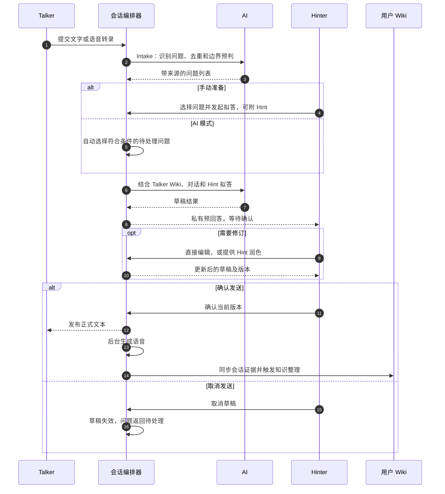
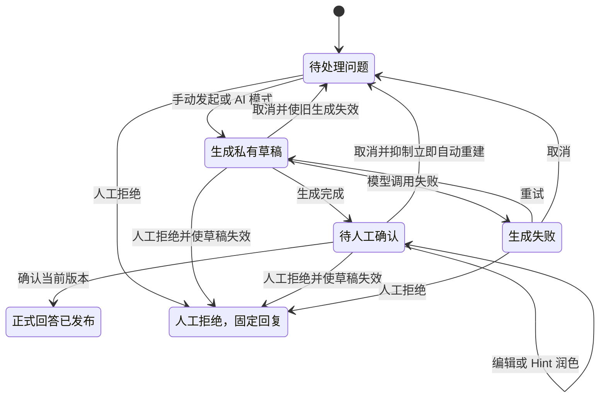
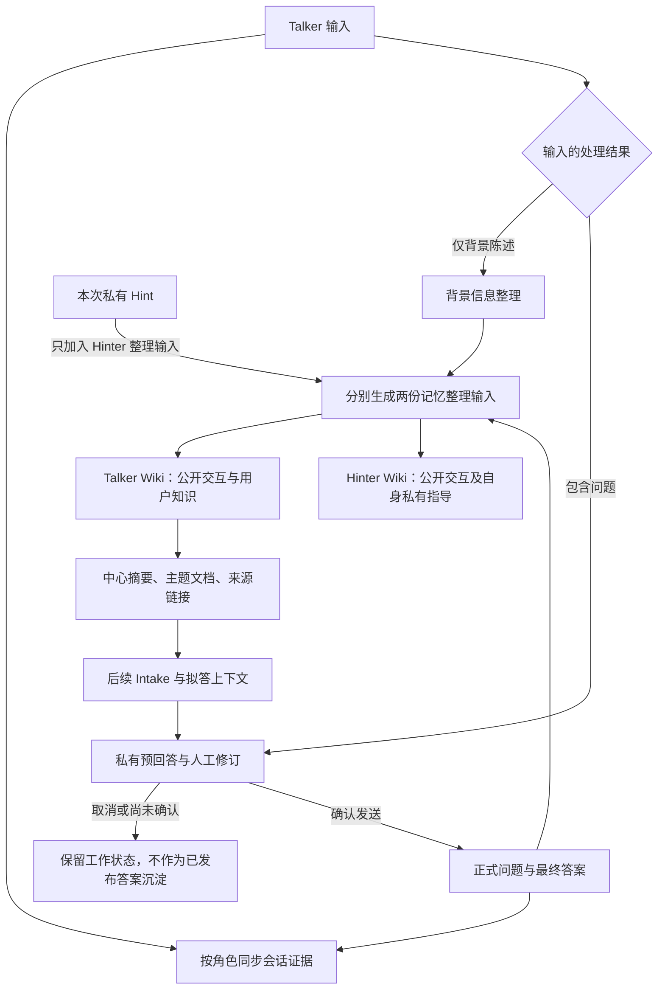

# Agent 开发创新点说明：双通道时机控制与用户级 LLM Wiki

> 基于 Duet AI 当前代码实现整理，适用于项目介绍、技术分享与架构讨论。

Duet AI 探索的是一种由用户、协作人员和模型共同完成问答的 Agent 工作方式：Talker 提出问题，Hinter 控制回答的内容与发布时机，AI 承担问题整理、拟答和知识维护。系统再把实际发生的交互沉淀到用户自己的 Wiki，使后续问答能够延续已有背景、结论和回答边界。

其中值得提炼的两项设计是：

1. **双通道协作与预回答机制**：把问题识别、草稿准备、人工修订和对外发布拆成独立阶段，让模型提前准备，让人决定何时形成正式回答。
2. **用户级 LLM Wiki 记忆机制**：把用户记忆组织成可编辑、有来源、能跨会话延续的 Markdown 文档空间，由模型维护知识组织，由代码约束写入边界。

本文所说的创新点，主要指面向具体场景的交互机制与工程组合。项目没有提出新的基础模型算法，也不以未经对照实验验证的性能数字作为结论。

## 一、双通道协作：让“生成时机”与“发布时机”分别可控

### 1. 从一条输入中整理出可处理的问题

自然交流中的一条消息，可能同时包含背景、多个问题和重复表达。系统先执行 Intake：识别问题、拆分独立诉求、合并重复项，并结合用户 Wiki 中的回答边界进行预判。Intake 只整理问题，不直接回答。

每个问题都有独立 ID、状态、版本和原始消息关联。这使 Hinter 可以选择单个问题或一批问题处理，而不必把整段聊天当作一个不可拆分的生成请求。没有提问的背景陈述则可以进入记忆整理流程，不会被强行转换成一条回答任务。

这一层的设计价值在于：**把连续对话转换为有来源、可排队、可分别决策的工作单元。**模型负责理解表达，应用代码负责后续状态推进。

### 2. Talker 通道承载正式交流，Hinter 通道承载私有准备

Talker 与 Hinter 共享同一个会话，但看到的内容不同。

|通道|主要内容|承担的职责|
|---|---|---|
|Talker|自己的输入、问题处理状态、已经发布的回答及语音|持续表达诉求，接收正式结果|
|Hinter|问题来源、私有 Hint、生成中的草稿、待确认答案及编辑操作|补充上下文、判断内容、决定发布或取消|

私有 Hint 可以指导答案的重点、表达和处理方式；系统通过 Prompt 要求模型不披露提示本身及协作人员身份。更直接的内容隔离由后端完成：`snapshot()` 根据角色投影消息和答案，Talker 只能获得状态为 `completed` 的 AI 回答，不能获得 Hinter 消息和未发布草稿。实时通道也使用角色对应的会话快照。

这里包含两种不同强度的约束：**未发布内容的接口可见性由代码控制，正式答案是否泄露私有语义仍需依赖模型遵循指令与人工审核。**

### 3. 两种准备模式，共用一个人工发布出口

系统提供手动准备和 AI 自动准备两种方式。

|阶段|手动准备|AI 模式|
|---|---|---|
|何时开始拟答|Hinter 选择问题并发起，可携带 Hint|开启后扫描已有待处理问题；后续 Intake 完成后自动排入拟答|
|拟答粒度|可逐题或批量|按问题分别准备草稿|
|生成后|进入 Hinter 的待确认区|同样进入 Hinter 的待确认区|
|何时对 Talker 可见|Hinter 确认发送后|Hinter 确认发送后|

**自动化改变的是准备答案的时机，最终发布仍是独立的人工动作。**代码中的 AI 模式复用现有拟答入口，不另建一套自动发布链路。它虽然会自动创建内部 review 记录并进入生成状态，但这不代表有人已经阅读或认可草稿内容。



预回答的价值在于让模型计算与人员等待发生重叠。例如，Hinter 尚未查看问题时，后台已经完成资料查询和草稿准备；Hinter 进入工作台后，可以直接判断一份具体答案。它还给了人可操作的审阅对象：直接修改文本、用 Hint 润色、确认或取消，而不只是在生成之前填写提示词。

若把“问题到达后，人员开始处理前的等待”记为 H，把模型生成耗时记为 G，在无需重新生成的简化场景中，提前准备可把串行的 H + G 压缩为近似 max(H, G)，之后再进行草稿审核与发布。这是设计层面的等待重叠关系，当前项目尚未测量实际节省比例；问题复杂度、模型失败和修订次数都会影响结果。

### 4. 用状态机承接人工操作与异步生成



*图中合并了答案、问题与生成任务的业务状态；Wiki 边界预判产生的 `blocked` 问题是另一条筛选分支，不能进入正常批准流程。*

这个流程中，有几处支撑体验的工程细节：

- **草稿版本校验**：编辑和润色会更新 `revision`，确认旧版本会被拒绝，避免用户阅读版本与实际发布版本不一致。
- **旧生成失效机制**：取消操作递增 `fence_token`；旧任务即使稍后返回，也不能继续把文本写回当前答案。正在进行的润色也会检查草稿状态和版本。
- **尊重取消决定**：取消后的问题设置 `auto_suppressed`，AI 模式不会立刻把它重新生成；人仍可再次手动发起。
- **等待时间不因内部动作清零**：从原始消息时间开始计时，生成、待确认和失败都继续计入等待，达到 3 分钟标橙、6 分钟标红。取消草稿不会让问题重新变成“刚到达”。
- **异步分离**：正式文本发布后，再后台执行语音合成和记忆整理；其中一项失败不要求撤回已经确认的答案。

服务重启时，待确认草稿保留为待确认状态；进行中的生成任务会恢复或重试，不会因为恢复流程而自动发送已有草稿。

这些机制使 Hinter 能在生成前、生成后和发布前介入，并让应用层明确处理介入带来的状态变化。当前取消机制主要阻止过期结果写回，不承诺立即终止已经发出的模型请求。

## 二、用户级 LLM Wiki：让记忆能积累，也能被用户理解和修改

### 1. 以用户组织记忆，以 Session 保存交互证据

项目使用稳定用户 ID 建立独立文档空间。Talker 与 Hinter 参与同一个 Session，各自的记忆空间仍然独立。

```text
data/wiki/
├── talker-001/
│   ├── context.md                 中心摘要、入口索引、回答边界
│   ├── notes/*.md                 自由组织的主题知识
│   └── sessions/<session-id>.md    Talker 可见的会话证据
└── hinter-001/
    ├── context.md
    ├── notes/*.md
    └── sessions/<session-id>.md    Hinter 可见的会话证据
```

`context.md` 提供简洁入口，主题文档保存较长说明，Session 文档保留实际交流及问题状态。新建对话只切换会话 ID 和中心文档中的当前轮次链接，历史 Wiki 会继续保留。

因此，记忆可以跨越多个对话轮次，同时保留“这条知识是在什么交流背景下形成的”的线索。其可迁移价值在于把用户身份与会话生命周期分别建模；当前 Demo 具体实现仍只有两个固定用户目录。

### 2. 保留证据与提炼知识分别执行

系统将记忆写入拆为两类操作。

|层次|写入内容与时机|主要职责|
|---|---|---|
|会话证据|同步用户输入、已经发布的 AI 回答及问题状态|代码按用户可见范围追加，并用消息 ID 标记减少重复记录|
|整理后的知识|处理背景陈述，或在正式答案发布后进行整理|LLM 更新中心摘要、主题文档和相互链接|

未确认、生成失败和已取消的 AI 草稿，不会被同步成已发布答案，也不触发正式问答结论的整理。人工拒绝则单独记录问题、固定回复和会话来源，并明确标注未形成实质答案。

这个区分决定了系统可以长期积累什么：**“模型曾经生成过”与“已经作为正式结果交付”是不同的记忆资格。**即使知识整理失败，会话证据仍能保留下来，后续可以人工查看或继续整理。



*Talker 的正式回答链读取 Talker Wiki；Hinter Wiki 用于维护协作侧自身记录。私有 Hint 通过显式参数参与本次拟答，不需要把整个 Hinter Wiki 混入 Talker 的上下文。*

### 3. 用 Prompt 定义知识组织方式，用代码约束保存操作

记忆整理 Prompt 允许模型根据内容选择主题、标题、文件名和链接关系。它要求保存的是可复用的知识，例如：

- 已有结论，以及结论适用的前提和来源。
- 计算方法中的公式、变量、实例和缺失条件。
- 开放问题中的假设、不确定性和后续确认方向。
- 用户偏好，以及自然语言描述的回答边界。
- 新内容与已有主题之间的联系。

这些方向以 Markdown 正文和链接表达，没有被固化为数据库里的知识类别枚举。调整整理 Prompt，就能改变知识编排方式，减少为新主题修改业务 schema 的成本。

与此同时，保存操作仍有明确的程序边界：

|环节|当前实现|
|---|---|
|整理输入|当前用户的 Wiki 上下文，加本次新信息；正式问答整理时，只有 Hinter 输入追加本次私有 Hint|
|模型输出|JSON 文档列表，每项包含 `path` 与完整 Markdown `content`；每次最多取 3 个文档|
|文件范围|限制在该用户 Wiki 目录内，文件类型为 `.md`；模型整理不能覆盖 `sessions/` 下的证据文件|
|冲突检测|生成前保存各文档内容摘要，写回时检查 `revision`，避免旧结果覆盖生成期间发生的人工编辑|
|单文件写入|先写临时文件，再替换目标文件|
|索引维护|要求新主题同步更新中心索引；应用层也会为已存在但未被索引的返回文档补充链接|
|清空后的旧任务|通过 Wiki 重置时间检查，丢弃跨越清空操作返回的旧整理结果|

保存流程可概括为：

```text
读取当前用户 Wiki 与各文档 revision
    → LLM 生成有限数量的文档更新
    → 检查 Wiki 是否已经清空重置
    → 检查路径、文件类型、证据目录限制
    → 校验 revision，跳过存在冲突的旧结果
    → 原子替换单个文件，补充中心索引
```

这种分工使模型能够参与知识组织，又让程序负责目录归属、并发冲突与持久化操作。需要保留人工回答边界、正确表达事实和不确定性等语义要求，目前主要由 Prompt 指导，尚不是确定性的内容校验。

### 4. 让用户拥有记忆的编辑入口

用户可以直接阅读、修改、新建和下载 Wiki 文档，修正错误结论或补充回答边界。这使记忆维护成为产品交互的一部分：用户能够知道系统保存了什么，并对后续问答的上下文进行干预。

自然语言回答边界会同时被 Intake 和回答 Prompt 读取。例如，用户可以声明某些主题缺少依据时先追问，或不能推测私人凭据。系统据此进行语义预判，但这一机制仍需要与正式权限控制区分开来。

读取侧采用有界上下文策略：排除其他历史 Session 的全文，将中心文档、主题文档与当前 Session 文档作为候选，最多拼接 20 份文档、截取 26000 字符。模型可以利用保存的摘要与知识，但当前没有按问题语义排序、递归遍历链接或向量检索；文档数量增加后，需要进一步改进召回策略。

## 三、两个设计如何共同形成闭环

双通道机制决定了一条 AI 草稿什么时候有资格成为正式交流结果；用户级 Wiki 进一步决定正式交流结果怎样被整理、归属和复用。

以一个假设的发布咨询为例：

1. Talker 先说明“团队跨时区协作”，该背景可以被整理到自己的 Wiki。
2. Talker 再询问“发布前需要做哪些演练”，系统提取出可处理的问题，并参考已有背景。
3. AI 模式提前准备草稿，Hinter 在私有通道补充处理重点，修改后确认发送。
4. Talker 收到最终回答；会话文档追加正式结果，记忆整理再提炼演练建议、适用条件和待确认事项。
5. 后续新对话可以继续使用这些知识，同时保留其建议性质；人工确认发布不等于相关业务事实已经验证或执行完成。

两项机制因此相互补充：**人工确认约束正式答案进入记忆的入口，用户 Wiki 为下一次问题理解和拟答提供可持续的背景。**

## 四、可提炼的技术贡献与当前边界

|技术贡献|可说明的实际价值|当前边界|
|---|---|---|
|问题级编排|把复杂输入拆成有来源、有状态的处理单元|识别与去重依赖模型及简单相似度判断|
|准备与发布分离|提前利用模型计算，又保留最终人工决定权|尚无等待时长、人工修订量的系统性对照数据|
|版本与过期写入控制|支持编辑、取消、失败重试与异步生成协作|主要适用于单服务实例，尚无分布式任务协调|
|用户级 Wiki|记忆跨会话保留，用户可查看和修改|只有固定 Demo 用户，尚未实现正式多用户权限体系|
|证据与知识分层|区分实际交流记录、草稿和可复用知识|来源可回到会话文档，尚无完整的结论级血缘追踪|
|Prompt 与写入约束协作|知识组织灵活，文件操作具有明确边界|多文档更新没有整体事务，语义质量仍需人工检查|

此外，答案发布审核只控制文本交付。当前 Agent 的工具可以在拟答期间执行，取消草稿不会自动回滚已经发生的 bash 文件修改或外部工具操作。若将这套模式用于具有写入副作用的业务，需要为工具动作单独设计权限与确认机制。

后续可以围绕两条主线验证效果：交互侧统计从提问到正式发布的时长、预回答命中率和人工修订量；记忆侧评估跨会话知识复用、来源保留、冲突处理和未发布内容误入记忆的情况。这些指标是建议的验证方向，不代表项目已经取得的量化成果。

## 五、实现索引

|实现位置|对应机制|
|---|---|
|[会话编排 service.py](../backend/app/application/service.py)|`run_intake`、`review`、`prepare_automatically`、`decide_answer`；草稿版本、过期写入控制与记忆整理触发|
|[Agent voice_agent.py](../backend/app/agent/voice_agent.py)|问题提取、拟答、私有 Hint 润色和 LLM 文档整理|
|[Wiki 存储 wiki.py](../backend/app/adapters/wiki.py)|用户目录、证据同步、内容摘要版本、有界上下文、原子文件替换|
|[记忆 Prompt memory.md](../backend/app/agent/prompts/memory.md)|知识组织原则、来源与不确定性保留、角色内容边界|
|[草稿操作 DraftDecision.tsx](../frontend/src/components/DraftDecision.tsx)|编辑、Hint 润色、确认与取消的交互入口|
|[问题计时 questionTime.ts](../frontend/src/lib/questionTime.ts)|等待时间计算、优先顺序和 3/6 分钟提示|
|[API routes.py](../backend/app/api/routes.py)|角色操作限制、Wiki 编辑及 HTTP/实时接口|

阅读实现细节可结合[技术实现与部署](technical-implementation.md)；工具调用与环境配置见[Agent 工具说明](agent-tools.md)。
