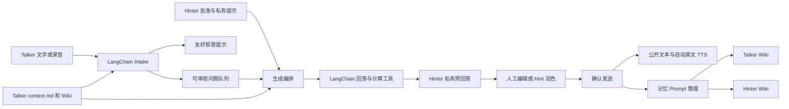

# Duet AI 技术实现与部署

## 实现目标

本项目把现有 UI 与 Spec 落为一个可直接操作的双通道网页 Agent。入口为 `http://127.0.0.1:8818`，支持 Talker 文字/语音输入、Hinter 问题审核与私有提示、AI 回答和语音播放、用户 Wiki 编辑、共享 Session 和清屏新建轮次。

Demo 只有两个固定用户：Talker 与 Hinter（需求中的 hitter 对应 UI 的 Hinter）。不引入注册、多租户管理和独立微服务。认证使用服务端签名的 Demo 身份；适合本机演示，后续多人部署可接入正式登录并使用稳定 user_id。

## 项目划分

```text
frontend/
  src/components/       页面、输入栏、问题审核、Wiki 编辑、音频与设置
  src/hooks/            会话实时连接、浏览器录音
  src/lib/              typed API client 与传输类型
backend/
  app/api/              FastAPI HTTP、WS、SSE、Demo 身份与音频授权
  app/application/      输入识别、审核、生成、重试与 Wiki 整理编排
  app/domain/           请求和 Intake schema，不定义知识分类
  app/agent/            LangChain 模型、Prompt、有限计算工具、LangGraph 风格决策图
  app/agent/prompts/    可修改的核心记忆 Prompt
  app/adapters/         SQLite、Markdown Wiki、STT/TTS
  data/                 本机持久化数据，已排除 Git
docs/                   技术说明
scripts/                构建与启动命令
Dockerfile              前端构建 + Python 服务多阶段镜像
compose.yaml            网页、Ollama 与模型初始化
```

React/TypeScript/Vite 提供页面，FastAPI 同源承载 API 和前端构建产物。一个服务实例即可运行，SQLite 保存会话状态与事件，Markdown 文件保存用户 Wiki。该实现采用 SQLite 和服务内异步任务替代原 Spec 的 PostgreSQL/Redis/outbox 集群，适配本机 Demo；没有声称满足原规格的生产容量、审计与高可用指标。

## 主流程与 Agent



业务状态由 Python 应用层维护。Intake 只输出问题、重复关系和必要的友好拒答，不生成答案。Hinter 请求预回答后调用草稿链；支持单个问题或批量问题，提示放在私有输入中，不出现在 Talker 接口或文档。草稿生成后还要确认发送，才成为公开答案。

LangChain 使用 `ChatPromptTemplate`、`ChatOllama` / `ChatOpenAI`、JSON/Text parser 和流式调用。回答时可调用 `calculate_expression`，最多处理三次工具调用；公式与变量从对话和 Wiki 文本推导，代码只提供有边界的算术执行，不维护公式类别表。模型不负责审核或决定状态跳转。

生成流只推送给 Hinter；生成完成进入 `pending_confirmation`，不发送给 Talker，不合成语音，也不写成已回答的 Wiki。确认发送后才发布公开答案、自动合成英文音频并运行 Wiki 整理。文档整理失败不回滚答案；完整原始问答仍在轮次 Markdown 中。LLM、STT、TTS 失败均保留已有信息，页面提供重试或转录补充。

## LLM Wiki 文档空间

```text
data/wiki/
  talker-001/
    context.md                  中心上下文、摘要、索引、自然语言回答边界
    sessions/<session-id>.md     该用户可见的原始对话及问题状态
    notes/*.md                  用户或 LLM 自由组织的主题知识
  hinter-001/
    context.md
    sessions/<session-id>.md
    notes/*.md
```

两个固定用户有稳定 ID：`talker-001`（真实用户）、`hinter-001`（审核与提示人员）。身份 token 包含 user_id，Session 关联两个 ID，Wiki 目录直接使用 user_id；可用 `TALKER_USER_ID` / `HINTER_USER_ID` 配置。每个用户拥有独立空间。Talker 的上下文用于公开回答，Hinter 的私有 Wiki 用于其自身记录。公共回答与 Talker 原始输入可以出现在两个空间，Hinter 提示只写入 Hinter 空间。后续新增用户可把固定目录名替换为 user_id，并在认证层限制目录归属。

`context.md` 是可编辑的中心文档。长短期记忆、当前状态、待回答问题、历史联系、计算方法、开放问题和禁止回答说明都以 Markdown 正文与链接组织。Wiki 读取以中心文档和当前轮次为基础，加载相关可见文档；Demo 限制上下文长度，避免无限拼接。

原需求中的五个方向是 Prompt 指导，不是类型枚举或数据库 category 字段。核心 Prompt 位于 `backend/app/agent/prompts/memory.md`。修改这个文档即可改变整理方式，允许新主题、混合内容与自由标题，无需改业务代码。用户声明的回答边界用自然语言保存在 Wiki，Intake 读取后进行语义预判，命中后问题不可批准；回答 Prompt 也读取边界。此机制是 Demo 的模型语义行为，不作为生产级绝对安全保证。

编辑页面可以修改任意 Markdown、创建文档、查看链接及下载文件。文档更新使用内容摘要作为 revision，人工编辑与自动整理发生冲突时保留人工编辑，提示重新加载。新建主题文档后可在 `context.md` 添加相对链接。原始对话证据持续追加，人工补充内容保留。

## 一次对话就是一个轮次

“新建对话 / 清屏”调用 `/api/v1/sessions/{id}/reset`，生成新 ID，清空界面消息与问题，保留两个用户的历史 Wiki。新中心上下文指向新的轮次文档，历史 Session 文档保留。同一旧 Session 上重复 reset 返回同一个新 Session；WebSocket 通知另一角色进入相同的新会话。

打开另一角色工作台或复制邀请链接即可协作。用户身份固定在当前页面，角色切换需返回入口；查询参数仅用于选择 Demo 角色，实际 API 权限依据服务端签名 token。

## 音频与实时能力

浏览器 `MediaRecorder` 保存原始录音，SpeechRecognition 可提供实时转录。录音结束后可编辑最终转录再发送；没有转录时后端使用外部兼容 STT 或本地 faster-whisper。浏览器权限、网络或模型不可用时支持手动填写转录，原音频依然保存。

AI 最终答案固定为英文，与问题、历史记忆和 Hinter 提示的语言无关；模型输出中文时执行完整英文转换后再完成答案并合成语音。页面不提供切换 AI 回答语言的选项。

TTS 默认使用 `en-US-AriaNeural` 英文神经声线生成 MP3，语速为 `-5%`。`TTS_ENGLISH_VOICE` 和 `TTS_RATE` 可在 `.env` 修改。网络不可用时 macOS 使用 Samantha 英文声线，Docker/Linux 使用英文 espeak-ng；再失败则提供英文浏览器语音降级。文本先从最终 Markdown 正文提取，只移除格式标记、保留所有段落，不另行摘要。音频记录包含准确的 `spoken_text` 和内容摘要，方便验证朗读与页面答案对应。

页面通过第一次点击或按键解锁同一个播放器，新答案的音频就绪后在 Talker 和 Hinter 页面自动播放。只有实际开始播放后才记录已播放，防止浏览器阻止时误标记；被限制时显示“点击播放”，并在下一次用户交互时重试。支持暂停、继续、进度调整和从头重播；快照重复推送不会重复朗读历史答案。

自动播放只消费带资源 ID 的实时事件，不以“当前会话发生了变化”作为条件：Talker 的 `message.created` 仅匹配当前新建的原音频，AI 的 `audio.ready` 仅匹配刚确认发布的 Answer。草稿、草稿润色、普通文本消息、问题计时刷新和历史快照不会朗读旧 AI 内容。设置中的“自动播放新语音”默认开启，存入浏览器 `localStorage` 并在同源 Talker/Hinter 标签页共享；关闭后不补播历史音频，新语音只能手动播放。

WebSocket 发送带 sequence 的角色快照更新，断线重连带游标，重复快照幂等；WebSocket 不可用时可降级 SSE。Demo 合并连续事件为最新快照，恢复最终状态，不承诺逐个展示每个 token 事件。

## 本机构建与启动

前置：Python 3.12、Node 20.19+ 或 22.12+、pnpm 10+。

```bash
./scripts/build.sh
# 可选：无外部凭据时使用本地模型
ollama serve
ollama pull qwen2.5:3b
# 另一个终端
./scripts/start.sh
```

访问 `http://127.0.0.1:8818`。服务端 Swagger 为 `/docs`，健康检查为 `/healthz`。停止本机前台服务用 Ctrl+C。已运行中的 Ollama 无需再启动。

模型列表仅在 `.env` 维护，服务启动时一次加载，不在页面展示模型、端点或切换入口。页面设置只负责会话与回答语言。配置变更后重启服务生效。详见下方模型配置与回退。

## Docker 一键部署

宿主机只需 Docker Engine / Docker Desktop 和 Compose 2.24.4+；启动 Docker 后在仓库根目录执行下列命令。不要求宿主机安装 Node、pnpm、Python、Ollama、ASR 或 TTS。默认 CPU 推理，首次构建与启动需联网下载镜像、软件包和模型。

```bash
./scripts/docker-up.sh  # 默认本地模型；配置外部模型时只启动网页服务
# 无外部模型配置时的等价命令
docker compose up -d --build --wait --wait-timeout 1800
```

无外部模型配置时，首次启动构建网页/API 镜像，并由 `model-init` 自动拉取 `OLLAMA_MODEL`（默认 `qwen2.5:3b`）。相同模型名传给后端，避免下载与调用不一致。网页容器的入口脚本自动准备 Zipformer、Silero、Kokoro、完整英文 Whisper 和 Smart Turn 模型，然后启动 API。准备失败会明确退出，不能把尚未准备语音的容器报告为可用。脚本最多等待 30 分钟，网络较慢时可通过日志查看进度并再次执行启动命令。网页地址为 `http://127.0.0.1:8818`。

依赖与配置的唯一维护位置：

| 内容 | 配置位置 | Docker 行为 |
| --- | --- | --- |
| Node 22、pnpm、Python 3.12、系统音频工具 | `Dockerfile` | 镜像内安装，不依赖宿主机 |
| 前端包 | `frontend/package.json`、`frontend/pnpm-lock.yaml` | 按锁文件安装并构建 |
| 后端 Python 包 | `backend/pyproject.toml` | 构建时安装，包括 ONNX、Whisper、Transformers |
| 模型地址、Key、主模型、通话参数 | `.env.example` → `.env` | Compose 传入容器，重建后生效 |
| 本地语音模型 | `scripts/prepare-voice.py` | 首次下载，保存在数据卷 |
| 工具与 MCP 设置 | 容器 `/app/data/agent-tools.json` | 首次创建，后续保留操作者修改 |

`.env` 可省略，此时使用默认本地模型。Compose YAML 负责服务、网络和卷，模型信息通常只改 `.env`。自定义路径必须是容器路径；宿主机路径需先显式挂载。`DUET_PREPARE_VOICE=0` 仅用于主动选择纯文本部署，默认完整准备语音功能。

系统包默认通过 Debian 官方 HTTPS 源下载。如当前网络下载很慢，可在 `.env` 设置 `DEBIAN_MIRROR=https://mirrors.ustc.edu.cn` 后使用同一启动命令；仍使用 Debian 的签名校验。

```bash
docker compose logs -f web model-init
docker compose ps
./scripts/docker-down.sh
```

停止不会删除数据。`duet-data` 保留 SQLite、Wiki、音频、语音模型、工具设置、`/app/data/workspace` 工作目录和 `/app/data/home` 用户配置；`ollama-data` 保留对话模型。重新部署复用这些数据。不要使用 `down -v`，除非明确需要删除全部演示数据。

外部模型部署只启动网页：

```bash
cp .env.example .env
# 编辑 .env 的 MODEL_CONFIG_JSON 和 PRIMARY_MODEL
./scripts/docker-up.sh
# 等价命令：
# docker compose -f compose.yaml -f compose.external.yaml up -d --build --wait --wait-timeout 1800 web
```

也可只填写 `DEEPSEEK_OFFICIAL_API_KEY` 接入官方模型，启动脚本会跳过 Ollama。`.env.example` 的默认值为空，不包含不可用的示例 Key；外部模型必须填写有效地址、模型 ID 和 Key。所有配置修改后重新运行启动命令，不用重装依赖。

默认一键安装覆盖 Python/npm 依赖和语音模型。飞书 CLI、第三方 MCP 服务和账号授权按需另行配置，不属于默认安装范围；镜像提供 Node/npm/npx 基础运行环境。

单独构建镜像：`docker build -t duet-ai .`。调整端口：`DUET_PORT=8819 docker compose up -d`。固定用户的 Wiki 位于容器 `/app/data/wiki/`。

## 基础接口与验证

入口包括 `/auth/demo`、`/sessions`、`/messages`、`/questions`、`/reviews`、`/answers`、`/wiki/document`和实时连接。完整运行时契约以 FastAPI `/docs` 为准；旧 Spec OpenAPI 中尚未实现的生产级资源不伪装为已实现接口。

执行 `backend/.venv/bin/python scripts/smoke.py` 可做在线准入检查。

仅保留少量准入检查：健康检查、双角色问答与隔离、Wiki 编辑与清屏持久化。构建执行 TypeScript 编译与 Vite 生产打包；Python 用 Ruff 和基础接口 smoke 进行验证。没有额外引入测试平台或大量约束性测试。

## 模型配置与回退

所有模型配置只来自 `.env`，原有 SQLite 模型设置不再使用。服务启动后加载一次，前端不接收模型列表、名称、API Key 或端点。页面只有会话与语言设置。

```dotenv
MODEL_CONFIG_JSON='[{"provider":"openai","model":"deepseek-endpoint-id","model_label":"DeepSeek","base_url":"https://your-service/v1","api_key":"YOUR_KEY"},{"provider":"openai","model":"kimi-endpoint-id","model_label":"Kimi","base_url":"https://your-service/v1","api_key":"YOUR_KEY"}]'
PRIMARY_MODEL=deepseek-endpoint-id
MODEL_TIMEOUT_SECONDS=35
MODEL_TEMPERATURE=0.3
STT_PROVIDER=local
STT_MODEL=whisper-1
```

`MODEL_CONFIG_JSON` 的数组顺序就是备用模型顺序。`PRIMARY_MODEL` 可以填写 endpoint ID 或配置中的显示名称，先调用主模型，再按数组顺序调用剩余模型。单项可以设置 `enabled: false` 禁用。每次 Agent 调用从主模型开始；429、欠费、失效端点、超时、网络中断、空结果或结构化结果错误时尝试下一模型。当前服务没有余额查询接口，不虚构剩余额度，按真实 API 结果回退。

如果配置了 `DEEPSEEK_OFFICIAL_API_KEY`，服务会把官方 DeepSeek 模型放到候选列表最前方；`DEEPSEEK_OFFICIAL_MODEL` 默认使用官方 `/models` 接口返回的低成本 `deepseek-flash`，并可通过 `PRIMARY_MODEL=deepseek-flash` 显式设为主模型。密钥仅保留在忽略提交的 `.env`，Docker Compose 会将其传入运行容器，前端和日志不返回该值。

本次参考配置实测后备用顺序为：DeepSeek V3.2 → Kimi K2.5 → GPT-OSS → Seed 1.8 → Seed 1.6 → Seed 1.6 Flash。DeepSeek V3.1 端点返回 404，排除；GPT-OSS 补足输出 token 配额后可返回正文。配置官方 DeepSeek key 后，官方 `deepseek-flash` 位于最前并作为主模型。可用性以调用时的供应商状态为准。

导入用户提供的 Go 内置配置：

```bash
backend/.venv/bin/python scripts/import-models.py /path/to/models_config.go
# 可选指定主模型
backend/.venv/bin/python scripts/import-models.py /path/to/models_config.go --primary Kimi-k2.5-256k
./scripts/start.sh
```

导入脚本逐项做少量连通测试，保留正常返回正文的模型，按 DeepSeek/Kimi/GPT/Seed 优先级排序，然后只写忽略提交的 `.env`。文件权限为 600，不把密钥写入源代码或文档。`scripts/start.sh` 与 Docker 均加载该文件。

回退层位于 `app/agent/model_router.py`，适用于问题识别、流式回答、计算后的结果解释及 Wiki 整理。流式回答中途失败时清除当前未完成文本，改由下一模型重新生成，避免拼接两个模型的半成品。全部模型失败时统一显示“所有 AI 模型暂时不可用”，保留输入和重试按钮；文本答案已经完成但 Wiki 整理失败时，保留答案及原始轮次文档并提示整理未完成。

Ark 文本模型与语音识别独立。默认本地 Whisper，第一次下载后缓存。`STT_PROVIDER=openai` 可选兼容音频转录服务；PyAV 固定在与 faster-whisper 兼容的范围。

## 本次验证与完成情况

- 前端 frozen-lockfile 安装、TypeScript 编译和生产打包通过；Python Ruff 与一条健康测试通过。
- 两个固定 ID、Wiki 隔离编辑、原始对话记录、新 Session 与跨轮次记忆保留通过基础接口 smoke。
- 真实浏览器验证：共享 Session 清屏、问题单选/全选、拒绝、直接及提示后回答、复制降级、音频播放/暂停/重播、录音上传和原音频回放、Wiki 新建/编辑/阅读/下载/删除；最终页面错误数为零。
- 模型实测：问题拆分、Wiki 自然语言拒答、无问题陈述、计算工具、Markdown 整理；失效主模型真实 404 后 Kimi 接管三个 Agent 阶段。
- 所有模型失败的接口状态和页面错误已验证，页面不显示模型列表；流式中途失败清除半成品并接管已验证。
- Docker 多阶段镜像、Compose 本地模型初始化和外部模型方式均实际启动；容器内生成可播放 WAV 并完成 Wiki 整理，本地 Whisper 转录已实际通过。

最终页面运行于 `http://127.0.0.1:8818`。上述实现覆盖本次 Demo 目标；注册、真实多用户登录与生产级 PostgreSQL/Redis 分布式能力按用户要求留作后续扩展。

## Hinter 预回答工作台

Hinter 的“AI 模式”是会话级开关，默认关闭，清屏创建新 Session 时保留开关状态。开启后，现有待审核问题和后续 Talker 输入中提取的问题都会逐条生成独立英文预回答。AI 模式不会自动发布，不能绕过确认发送。关闭时停止自动排入新问题，已生成或生成中的草稿仍可查看、确认或取消。

草稿气泡有以下操作：

- **编辑**：直接修改英文 Markdown 正文，保存后继续待确认。
- **AI 润色**：输入私有 Hint，模型通过现有主备回退链润色，结果仍是草稿。
- **确认发送**：把当前版本的精确文本发送到 Talker，随后播放英文语音和整理 Wiki。
- **取消发送**：撤销草稿，关联问题返回待审核，原始等待时钟不重置。AI 模式不会立即重建这个取消项；仍可手工重新生成。

后端以字段投影隔离草稿（HTTP、WS、SSE、对话记录和音频路径）。草稿 `revision` 防止两个人工窗口发送旧版本，取消令牌使旧生成或润色任务不能回写。生成失败可重试；服务重启保留待确认草稿，不能自动发送。

主要接口：`PUT /api/v1/sessions/{id}/ai-mode`，`PUT .../answers/{id}/draft`，`POST .../answers/{id}/polish`，`POST .../answers/{id}/decision`（confirm/cancel）。只有 Hinter 身份可以调用。

## 未回答计时与拒绝

每个问题从源消息创建时间开始等待，在待审核、生成草稿、待确认、失败重试时持续计时。达到 3 分钟标橙、6 分钟标红；未处理问题按最早创建时间排序，优先于已回答/拒绝的历史项。计时每秒更新，取消或重新生成不会清零。只有确认发布或拒绝处理后停止等待。

Hinter 可在问题列表逐个拒绝，也可选中后批量拒绝。生成或待确认的关联草稿会一并失效。拒绝不调用模型编造答案，直接发布 `Sorry, I dont know.` 并自动播放英文语音，问题置为 rejected。`notes/rejections.md` 立即保存问题、固定回复与来源，并链接到中心 context.md，记录未形成事实答案；它仍是可编辑自由文本，保留 Prompt 驱动的记忆设计。

## 全量 Wiki 删除

Hinter Wiki 编辑页提供“删除全部 Wiki”。先进入二次确认弹窗，必须完整输入 `我已确认删除所有的Wiki信息`，按钮才启用；后端 `POST /api/v1/wiki/clear` 再校验身份及精确语句。清空两个用户空间的中心内容、主题文档与历史轮次文档，仅重建空白 context.md 以便继续使用。聊天状态和音频保留，已删除记忆不会由旧对话同步自动恢复。

删除时记录重置时间，忽略仍在等待模型的旧 Wiki 写入和已清除轮次的信息。后续新输入和新确认发布的答案可形成新 Wiki。此次实际删除验证全部在独立数据目录运行，没有清空用户正在使用的 Demo Wiki。

### 新增工作台实测

使用独立服务和数据目录验证了完整页面流程：AI 模式自动产生三条草稿；Talker 在确认前看不到答案；人工修改和 Hint 润色后发布文本与预览一致；取消不发送；3/6 分钟标色、按等待时间排序与每秒计时正确；拒绝回复与 Wiki 留档正确；输入错误确认语句不会删除，精确语句可清空两个隔离 Wiki。浏览器页面错误数为零。用户正在使用的 Wiki 未被删除。
