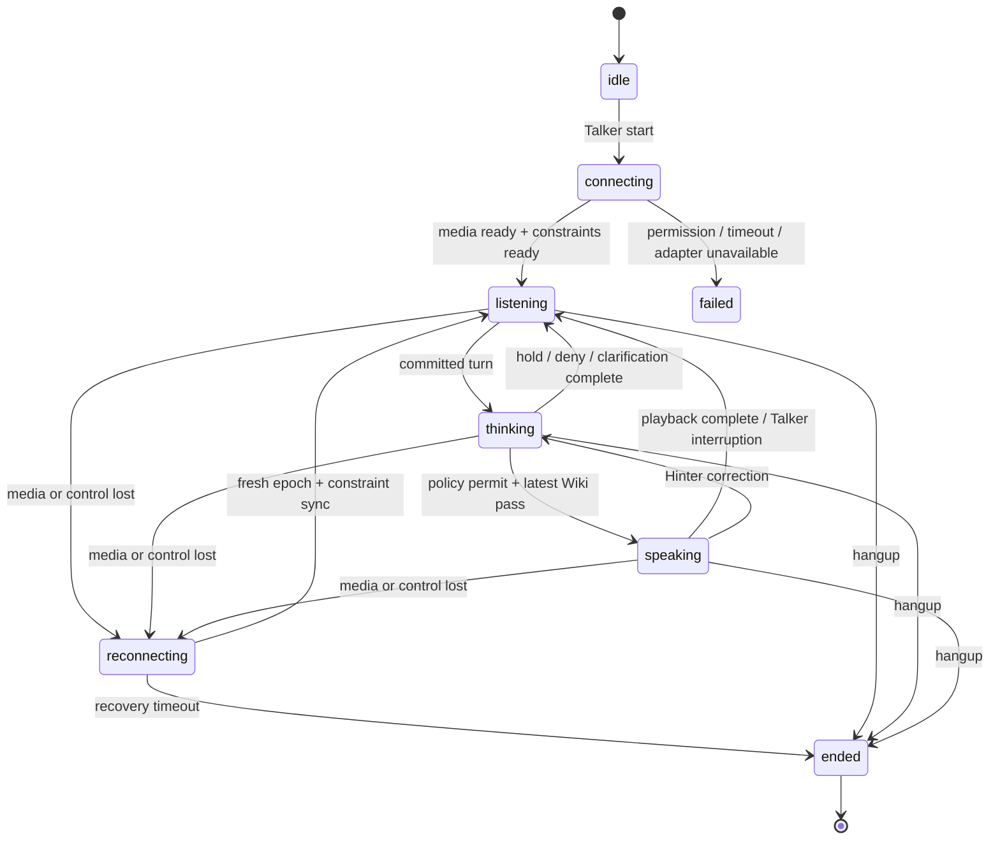
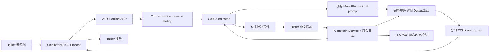

## Context

> 第一版已实施，具体差异见 implementation-status.md。后续用户要求修复分轮/打断/英文识别，最新修正规格见 [fix-call-turn-taking](../fix-call-turn-taking/design.md)：三秒有效静音聚合、独立直连校正、确认插话及分阶段延迟取代本文相应初始参数；本文其余内容保留为第一版设计背景。

现有系统保留为审核聊天模式。用户本次要求新增“电话客服”：Talker 持续用英文说话，Hinter 通过中文文字指导，AI 自主处理常规问答，仅在特定情形请求帮助。题面截图作为需求背景，采用用户明确提出的增量范围；图片中的说明不视为执行外部操作的授权。

当前系统是 React + FastAPI + LangChain + SQLite + Markdown Wiki 的单进程 Demo。LLM 已有文本流，但前后音频链路不是流式。两个固定用户及后端字段投影继续沿用；不在本 change 顺带改造成生产多租户平台。后续扩展真实身份时必须将本文 scope 映射为服务端认证的 tenant/customer/session，不接受客户端任意指定身份。

旧 `.specify/memory/constitution.md` 的“审核先于生成”和“一次批准、一个 generation”只适用于旧模式；本次提案明确设计通话模式的替代不变量，实施前同步修订其适用范围。

## Goals / Non-Goals

**Goals:**

- 单次接通后无需反复点录音/发送，持续接收英文语音，自然分轮并简短英文回应。
- 普通问题自动回答；开放新领域、业务数据请求和危害问题有可解释的差异化策略。
- Hinter 可离开逐题审批位置，以滚动记录/提醒监管，随时插入中文提示或中止回答。
- 提示持久化到 LLM Wiki 核心约束，优先于普通记忆，输出前用最新版本校验。
- 为当前 session 提速和通话延迟提供可测指标、原型验收与时序测试。

**Non-Goals:**

- 本轮不实施功能；不废弃旧审核聊天，不自动迁移旧记录到新语义。
- 本期不接 PSTN/真实手机号、不做 Hinter 第二路语音、不做多人会议。
- 不保证 ASR、模型或语义校验绝对正确；以证据、澄清、人工干预及测试降低错误。
- 不将人类“批准回答”等同于可越权查询数据或可执行危险工具。

## Decisions

### D1. 双模式，以 Call 作为 Session 下的独立生命周期

`Session.interaction_mode` 默认 `review_chat`；Talker 显式“开始 AI 通话”成功后进入 `realtime_call`。每次 call 有独立 ID、连接代次与轮次，挂断后回到 review_chat。已有会话无该字段时按旧模式读取。

仅允许同一 session 一个活动 call、一个 Talker 媒体发布者、一个实质答复输出者。切换前检查在途录音、草稿生成/TTS；有冲突返回 `409 MODE_TRANSITION_BUSY`，用户在现有控件完成/取消后重试。旧 pending_review 队列保留，通话中不自动回答这些历史问题，旧确认接口也不能把历史语音插入活动通话。



这是用户展示的主要相位；`capture_state`、`supervision_mode`、每问题 review_state 是独立维度。例如 waiting review 时仍可 listening，不以一个全局“待审核”冻结整通电话。

### D2. Pipecat 只负责媒体，确定性业务控制沿用项目

选型依据与替代见 [research.md](research.md)。新增 `CallCoordinator`、`StreamingASRAdapter`、`StreamingTTSAdapter`、`PolicyEngine`、`ConstraintService` 和 `OutputGate`；通过 FrameProcessor/adapter 桥接，不用框架 Agent 自主批准业务。



媒体通过 WebRTC 连续传输；FastAPI HTTP/WS 承载已认证信令与业务控制。ASR 的音频重采样、单声道与采样率依 adapter 协商，不假定浏览器一定录到 16kHz。输入包目标 20–40ms，实际 RTP packetization 以协商为准；ASR 模型 chunk/cache 独立，不把包大小和模型推理窗口混为一谈。

Pipecat 的 RTVI 事件只能经角色投影桥接；默认 bot text、LLM trace、tool 信息不得直发 Talker。媒体只接入最终通过 Gate 的答复和经校验固定话术。

当 WebRTC 建链失败时，显示可操作失败或使用另行实现并验证的 AudioWorklet PCM WebSocket 持续流模式。SSE 仅补充控制事件，不能替代双向语音。第一版可仅支持 WebRTC 并明确能力不支持；不能偷偷走上传接口宣称通话成功。

### D3. 分轮、问题拆分与回答时机分开管理

- `transcript.partial` 用于字幕、预取只读记忆与低成本风险预警，禁止执行工具、持久化事实或公开回答。
- VAD确认约三秒有效静音后冻结用户轮次，最终ASR和独立直连校正完成才提交；ASR endpoint只作为内部分片，不直接得到业务 `turn.final`。随后Intake输出schema化问题项（来源span、顺序、依赖、置信度、intent/domain/风险信号），与当前活动问题集去重。不能把整个历史Session作为每轮必传上下文。
- 高置信度普通单问题可由合并 Intake/路由调用进入自动路径；无法形成有效结构化结果必须澄清/hold，不用原始 partial 直接作答。合并模型调用减少串行开销，状态迁移仍由代码决定。
- 语气词、感谢/寒暄有会话意图，无问号不等于没有需要回应；噪声/纯背景音不回答。低置信度数字/ID必须复述确认，禁止自动“修正”实体。
- 同轮可拆多个问题：按说话顺序与依赖关系处理；常规问题允许合成一次短答，独立待审核问题挂起，其余继续。依赖待审核数据的总结题一并挂起，不能用猜测完成。
- 同一来源/版本重复 final 只处理一次。跨轮重复问题可以是追问或要求重说，必须保留新的 turn，并重新检查时效和当前约束；禁止永久语义去重导致 AI 不回应。

默认每次 1–3 个英文句子、目标 20–60 词。长答案拆为“简短结论 + 是否继续”，续说属于新的输出单元并重新校验；不再继承现有 150–250 词批量草稿 prompt。

### D4. 策略分级与例外人工审核

|动作|意义|默认例子|人工不在线|
|---|---|---|---|
|`auto`|直接生成并通过 Wiki gate 后回答|已知领域常识、普通澄清/追问|正常通话|
|`notify`|允许回答，向监管时间线添加聚合提醒|安全语境中的轻度粗俗措辞|继续回答，提醒待读|
|`hold`|该问题禁止实质回答/相关工具，等待明确批准/提示|人生意义等开放新领域、真实 DAU 或 ID 查询、低置信度风险分类|只说一次简短等待/澄清；超时不自动批准|
|`deny`|拒绝危害部分并提醒；可给安全替代|明确要求犯罪操作或血腥暴力伤害协助|直接安全拒绝，无需等人批准|

严格度 `deny > hold > notify > auto`。自动硬限制与 Wiki 核心限制不能被 Hinter 一次批准绕过。`hold` 审核只解除相应问题版本的策略等待；真实数据查询还需工具、资源、用途/范围授权。原始数据值/ID 必须走受控工具，不能在 Intake 前通过自动文档预读、bash、MCP、缓存回放或网页搜索旁路获取。

“新问题”定义为新的开放领域/缺少适用处理策略，并非第一次听到的所有句子。默认“人生的意义”等待提示，但问“photosynthesis 是什么”可自动答；未知领域通过配置的 domain registry 和保守置信度判断。可以由 Hinter 为领域补充有期限约束，未来相似问题仍按有效策略评估，不自动永久放行。

“违法、血腥、暴力”是风险类别，不是单词有罪。正常科普、预防诈骗、新闻/文学上下文与危险协助区分；直接危险协助不可人工强行批准。原问题模糊时澄清而非补全危险意图。词表来自离线固定来源并记录许可，示例策略见 [policy-seed.yaml](policy-seed.yaml)。

`hold` 仍允许经过约束校验的固定短句，如 “Let me check that before I answer.”；默认 20 秒无处理标记过期并说 “I can’t verify that right now. We can move on.”。等待期间无重复催促、不自动放行，可答独立新问题。恢复旧问题必须重新验证相关性、问题版本、授权与 Wiki，再决定是否在当前轮之后播出，不能突然打断正在回应的新问题。

### D5. Hinter 是可随时介入的监管者

监管页主区按序滚动：原始/修订后的转写、问题拆分、处理状态、公开英文答复和实际已播范围；侧边聚合待处理风险。正常内容只更新记录，`hold/deny` 提醒（应用内声音/角标；浏览器通知需已有用户授权），`notify` 默认仅角标。阅读历史时不抢滚动位置，显示“新增 N 条/回到最新”。

支持“追加约束（后续生效）”“立即纠正（停止并重答）”“别回答（当前目标阻断）”“暂停自动回答/恢复”。未指定目标时服务端解析到当前 active turn/response；无活动回答时作用于下一轮并在 ack 中显示实际 scope。默认 scope 是本 call；跨 session 持续约束需 Hinter 显式选择用户/客户 scope。普通输入默认立即纠正当前回答，以满足随时插话；对后续提示有单独选项。

“立即停止”控制不等待语义模型解析或 Markdown 渲染。服务端先推进 response epoch、撤销输出 permit 并发停播，再持久化中文原文；写入失败仍保持静默，提示重试，不能继续播放。普通补充写入成功后才返回 `hint.effective`。暂停可持久化为有效约束及 supervision_mode，恢复必须由 Hinter 明确触发且不放行 deny。

Hinter 的补充不需要透露给 Talker；可约束已授权事实表达、提供答案、修正数字或禁止回答，但不应把私有全文直接读出。长文档异步解析/索引，提示显示 `indexing`，目标问题保持 hold；未完成不得声称核心内容已生效。这里是 LLM Wiki，不是飞书 Wiki；本次不会修改任何外部云文档。

### D6. 核心约束为可恢复 LLM Wiki 内容

沿用用户 Markdown Wiki，新增 Hinter 私有 `constraints/` 文档和索引，不与 Talker 的事实记忆混成一份。核心约束必须参与模型上下文，不能继续仅 `bundle("talker", session_id)`。

每条 `ConstraintRecord` 保存原文、规范化解释、来源、scope、有效期、修订/撤销关系和 sensitivity。原文是事实源，模型提取只是辅助；提取不确定时 hold 并请求澄清，不能悄悄丢弃。短数字 hint 需要目标语义，例如上下文明确问 DAU 时“1234”绑定该问题，不跨问题复用；歧义则澄清。

SQLite 事务先提交 constraint append log、有效 revision 和 projection outbox；立即装配内存索引，异步原子替换 Markdown。这样处理现有 SQLite/文件不能跨存储事务的问题：UI 分别显示 `effective` 与 `wiki_synced`，只有后者声称 Markdown 已同步。启动恢复先重放日志并修复投影，恢复完成前禁止自动回答；用户所说“存进 LLM Wiki”由持久原文、可见文档及可恢复索引共同保证，不能只留下易失 prompt。

约束优先级：系统安全/输出语言/权限 > 有效 Hinter 核心约束 > 该客户/用户的已确认事实 > 当前通话上下文 > 普通知识。scope 只决定适用性，不自动凌驾更高优先级；同权限同逻辑 key 的显式 revision/supersedes 才替换旧值。不同 key 的矛盾、跨 scope 冲突或无法判断不靠“最后一句 wins”，而是 hold 并请 Hinter 解决。

检索后的文档/网页/对话是数据，不得自行注册核心约束。核心约束不进入普通 Wiki 文档数量或字符截断；若总约束超限，压缩需有原文链接与等价核对，无法保证则暂停输出并提示整理。删除/清空核心约束必须通过有 revision 的撤销命令；活动 call 中通用清空 Wiki 返回 `409 ACTIVE_CALL_CONSTRAINTS`，避免绕过 fence。

### D7. 完整短答校验后再发声

为满足“最终输出也校验 Wiki”，本版选择**每个短答完整缓冲、完整校验，再分句发声**。输入流和媒体流始终持续，不需要 Talker 停录上传；但不会把未经全答复校验的首 token 直接喂给 TTS。逐句先播后终审存在不可撤销泄漏，第一版不选。

OutputGate 输入：完整候选、问题/策略决定、工具授权与证据、当前全部有效核心约束、召回事实/修订、输出 epoch。先跑确定性检查（权限、版本、语言、长度、禁止公开字段与 canary、数据出处/实体），再语义检查（是否遵循中文提示、是否与已确认事实冲突、是否泄露私有信息、是否臆测）。不能只比较 Markdown hash 就声称完成语义校验。

校验结果 `pass / revise / hold / deny`，输出内部 `OutputCheck`。限制最多一次重写并重新校验；超时/检索失败/冲突/版本反复变化时 hold，给经过相同权限和约束检查的简短安全话术；连安全话术也冲突则保持静默并提醒 Hinter。安全话术不代替首个实质答复的性能指标。

发放 `OutputPermit(response_id, epoch, policy_revision, constraint_revision, facts_revision, candidate_hash)`；传给 TTS 的文本必须与校验候选同 hash，`spoken_text` 仅有可审计的发音规范化。每批音频发送前复核 permit 和 revision。最终快照记录 check 与播出游标，不能用后来的 Wiki 覆盖历史校验依据。语义 gate 是降低错误的控制措施，不是事实正确性的数学证明。

#### 生成、提示、播放竞态

```mermaid
sequenceDiagram
    participant T as Talker
    participant C as Coordinator
    participant H as Hinter
    participant K as Constraint/Wiki
    participant G as OutputGate
    T->>C: continuous audio → turn.final
    C->>C: questions + policy.auto; epoch=7
    C->>G: short candidate, constraint rev=11
    H->>C: 立即纠正：不要报旧数字
    C->>C: epoch=8, revoke permits
    C-->>T: playback.stop + clear
    C->>K: durable constraint rev=12 + outbox
    K-->>H: hint.effective / later wiki_synced
    G-->>C: old pass rev=11 / epoch=7
    C->>C: discard stale check/audio
    C->>G: regenerated candidate, rev=12 / epoch=8
    G-->>C: pass, permit
    C-->>T: verified text + streamed audio
```

安全边界是服务端接收并序列化插话的时刻；此前已经听到的语音无法撤回，记录为 `interrupted` 并保留已播范围，必要时下一轮简短纠正。WebRTC 原始 RTP 没有应用 epoch，因此需要接收端立即关闭/暂停旧播放路径，清理自有缓冲，并在 `playback.begin(epoch)` 同步后重建/恢复接收路径。实现时验证实际 SDK 行为，不能只在 JSON 上加 epoch 就假定扬声器无尾音。

Talker 说话触发快速本地 duck/静音以及后端打断；Hinter stop 通过优先控制事件停止 LLM/TTS、撤销 permit。worker 完成太晚不得写已完成；取消推理不支持时在隔离 worker 丢弃结果。短 backchannel/咳嗽误触发由可配置最小语音时长与恢复逻辑评测，默认不自动恢复任何被新约束撤销的旧音频。

上下文中的 AI 内容仅包含确认已播片段；未发候选/未播尾部不是“AI 已经告诉 Talker 的事实”。无词级对齐时已播范围用保守估计标记，不捏造精确单词游标。

### D8. 先改善现有 session 的可见延迟

优先新增分阶段测量；推理移出 session 锁，通过输入版本/epoch 校验提交；Whisper/客户端实例预热复用；Wiki revision 缓存、按需读取；旧模式批量推理预算与 prompt 瘦身；WS 控制事件直接唤醒，保留游标恢复；同步 SQLite/Markdown/CPU 推理移出 event loop。音频帧不持久化成全量 session snapshot。

新通话使用每 call 独立有界缓冲、背压和超时预算，停止命令走高优先级路径。默认音频待发队列不超过 250ms，输入等待队列不超过 1s；无法保持时标记 degraded 并暂停当前回答/要求重说，禁止积压数十秒后补播。网络/模型性能不能通过取消风控校验换取。

后续修订：三秒停顿是有意产品等待，从用户实际说完到首音须包含它，原TTFA P50≤1.5s/P95≤3s目标不再适用。分开记录静音、最终ASR、校正、主Agent与实际播放；插话记录有效语音开始→确认→停播，不隐藏检测等待。确认后停播≤200ms、Hinter停止/短提示≤300ms仅为待验证目标；本轮只做代表性实听/回放，不要求百轮基准作为功能前置门禁。详见fix-call-turn-taking及最新capability。

### D9. 权限、日志与工具副作用

后端按角色输出白名单。Talker 只得已发布英文回答、自己的转写、必要通话状态；私有 hint、风控命中原文、Wiki 证据/ID、内部候选、工具 trace 不经 WS、SSE、RTVI、异常或音轨泄漏。Hinter 默认不采集麦克风，实时监听也默认关闭，避免双标签播放回灌。

call 工具 allowlist 默认仅纯计算；网页/文档读取亦为受限资源动作，先经路由与授权。bash、任意 MCP、本地文件/环境变量访问在 call 不注册。批准数据查询绑定 tool+resource+args hash+scope+question version+expiry，结果带来源/时间/实体，输出前再检查。批准回答不赋予新工具权限；重试同一请求不重复副作用。

存储原音频采用异步分段归档，只有完整上传成功才提供可回放标记，归档失败不阻塞通话但告警。内容日志私有受控，指标只记 ID/耗时/类别；跨 session 或用户 scope 内容不得混入约束索引。

## Risks / Trade-offs

- 完整短答与语义复核增加首音延迟 → 缩短回答、合并 Intake/路由、预热与有界召回；根据测量调整 adapter，不取消 gate。
- ASR 数字与分轮出错 → 保留原始流转写版本，实体澄清；原音频可追踪，不许诺零错误。
- 核心约束频繁更新造成饥饿 → 有界重试后 hold 并显示约束变动原因，不无限重生成。
- Wiki 文件/SQLite 双写分裂 → 持久 outbox、原子文件替换与重建；恢复未完成禁止通话实质输出。
- 关键词误报、语义模型漏报 → 规则、意图、上下文组合和中英反例回归；策略灰度/版本回滚。
- NAT/浏览器尾音和回声 → STUN/TURN、耳机/AEC 测试、客户端停播 ack，媒体 worker 隔离。
- 单进程重启导致通话丢失 → 明确 ended/recovery，不恢复旧音频；保留有效用户级约束与已播记录。

## Migration Plan

1. 文档阶段：保留本 change 未归档；现有 `specs`/constitution 标记为旧模式依据，本次不修改其已记录的实现结论。
2. 实施起始：按模式修订 constitution I/V/VI 和 `specs/README.md`；新不变量为“任何公开 call 输出必须有当前有效策略许可与 Wiki check，hold 必须人工批准”；默认配置仍 review_chat。
3. 先做现有 session 埋点/锁与模型复用优化，旧审核/投影回归通过；每项优化保存基线对照。
4. 为 SQLite/state 添加兼容默认字段，持久 constraint log/outbox；启动修复投影，迁移不复制 Hinter 私有内容到 Talker Wiki。
5. 本地 spike 验证媒体、ASR/TTS 与停播，锁定依赖/权重；再用 feature flag 开放小范围 call。
6. 实现路由、干预、Gate 与监管页，先演示竞态/越权/故障，再跑持续通话和延迟验收。验收不足保持 disabled/degraded，有明确原因。
7. 回滚关闭 call flag、主动挂断并推进 epoch，保留记录与约束；旧页面继续服务。不得删除新增数据以求回滚。

## Open Questions

不阻碍本设计的默认选择：浏览器通话；开放哲学/新领域默认 hold；人不在线不自动放行；通话级 hint 默认随 call 结束失效但保留证据，跨通话约束需明确 scope。

实施 spike 需确认：目标硬件/网络、所选英文模型快照、包依赖交集、真实停播尾音、完整校验可用模型与成本。若未来明确需要真实号码，再以独立 change 扩展 SIP/LiveKit 评估，不能把当前浏览器接通当成拨打电话运营商号码。
