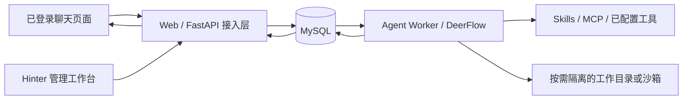

# 个人员工 Agent 技术设计

## 1. 目标与现状

目标是一个可持续对话、整理会议记录、调用工具完成工作任务的个人员工。会议记录助手是首个工作配置，问答是其中一种输入意图。

现状是自研 FastAPI 服务调用 `CallReasoner`、`VoiceAgent` 与自研决策图，SQLite 保存会话快照，Markdown Wiki 保存记忆。现状不等于完整 DeerFlow。实施后，Agent 规划、工具循环、子任务、上下文压缩和记忆调用均走真实 DeerFlow 运行时。

## 2. 唯一执行核与服务边界

### 决策

1. 首期以官方 embedded client / harness 接入独立 `agent-worker`。固定官方 2.x 的已验证版本与 commit，记录依赖锁和适配补丁；构建后运行真实 `DeerFlowClient` / lead agent。
2. `web` 负责认证、RBAC、请求落库、语音传输和前端事件适配；不执行另一套规划、路由或回答模型。
3. worker 从 MySQL 领取通用 Run，调用 DeerFlow 并持久化原生事件、checkpoint 与记忆。同步流接口需要在线程或独立 worker 执行，不能阻塞 FastAPI 的音频/控制事件循环。
   STT/TTS 保留为音频适配；需要 LLM 的语义校正同样接入 DeerFlow 的受控技能，不保留独立自研语义 Agent 旁路。
4. 工具、MCP、Skills、子 Agent、上下文压缩和记忆使用同一 DeerFlow 配置体系；本地适配只处理身份、存储、受控提示和产品事件。
5. 生产入口不保留“DeerFlow 不可用就切回自研问答 Agent”的双轨路径。运行时加载失败应显示明确错误并阻止接收新 Run。
6. 官方当前数据库配置未直接提供 MySQL。MySQL persistence provider、checkpointer/store、记忆读写和应用记录的适配是交付前置工作，详见配套 change；不能只替换数据库 URL。

第一项实施任务必须证明固定版本的 embedded 入口能够注入所需 MySQL provider。若需要上游小范围补丁，只修改持久化扩展与身份边界，不复制 lead agent 的业务流程；兼容性验证通过后才进入页面接线。

## 3. Agent 工作配置

Agent 定义为带版本的配置：`agent_id`、`name`、`description`、`profile`、`prompt_version`、`enabled_tools`、`enabled_skills`。用户界面展示名称、简介、当前能力和运行状态，不暴露模型密钥或系统提示。

基础配置 `personal_employee`：

- 理解用户的目标、连续发言、请求、资料与纠正；有问号与否不影响记录或执行。
- 能根据需要检索、调用工具、整理文本、产出工作结果，并说明证据与限制。
- 将用户事实、会议记录、待办与 Agent 推断区分开；不虚构完成操作或缺失指标。
- 只在影响工作结果的关键信息不明确时询问具体细节，不要求所有输入都重述为完整问题。
- 实际失败、缺少数据和权限不足有对应状态与说明，不统一改写为固定的 “I don't know.”。
- 输出语言服从用户/会话设置，未指定时遵循当前交流语言；会议记录保留原始语言，不把历史英文口语场景硬编码到所有任务。

工作配置 `meeting_assistant` 在基础配置上强调：持续保存会议发言、处理“这句话更正为……”等修订、提取明确提出的问题，能回答会议中的询问和用户要求的整理任务。未明确的发言人保留 `unknown`，不能根据猜测给出实名。

本期原始记录和问题投影必须可用。用户通过聊天要求整理一段内容属于通用 Agent 能力；独立的摘要展示模式、周期性自动纪要与外发分发属于后续扩展。

## 4. 统一记录与投影

会话真实来源是 `conversation_records`，而不是 question 表。记录具有 `record_id`、`thread_id`、`owner_user_id`、`actor_user_id`、`actor_type`、`kind`、`visibility`、`source_record_id`、`revision`、`created_at`。

- `kind` 区分用户文本、转写、管理员上下文、助手输出、工具结果引用和纠正。
- `actor_user_id` 是实际操作者；Hinter 代选用户空间时不能冒充空间所有者。
- 录音/附件保存在受控持久卷，MySQL 保存元数据、所有权与引用；临时识别分片不作为独立会议发言。
- 转写修订保留旧版本与来源，引用旧版本的展示投影标记过时并重新生成，不在原文中静默覆盖。

`presentation_mode=questions` 是首期默认。问题提取独立订阅已提交记录，生成 `record_projections`，保留来源记录、版本和原文范围。没有明确问题的发言仍保存到聊天记录并交给通用 Agent，不能被提取器丢弃。提取失败不会阻塞主 Run。

需要 LLM 的问题提取通过 DeerFlow skill/通用后台 Run 实现，纯格式投影可确定性处理；不再建立另一套自研模型路由或问答执行链。

后续 `summary`、`action_items` 可增加投影实现，复用原始记录；一期 UI 不展示未实现入口，请求未实现模式返回能力不支持。问题视图的状态只描述提取或任务关联，不复活旧的逐题审批与固定补答状态机。

## 5. 通用 Run 生命周期

每次输入先持久化记录和幂等键，再建立 Run；worker 用数据库租约领取任务。每个 Run 有稳定 ID、执行尝试号、来源记录和明确的终态。

- 同一 thread 的常规 Run 默认按序执行；不同用户/thread 可并发，子任务并行由 DeerFlow 管理。
- 新输入可排队或显式发送停止控制。用户说话触发的音频打断先停止播放，是否取消正在执行的 Run 由明确控制事件决定；不能将播放中断自动解释为删除工作任务。
- 已接收的 Run 不因 HTTP 请求结束或页面关闭而消失。进程异常后按 checkpoint 与租约恢复；用户主动取消的 Run 不自动重启。
- 外部读取可在预算内重试；可能产生外部写入的工具操作需要幂等标识与完成记录，重启后不能盲目重复执行。
- 本期恢复单位是通用 Run，不为历史每个 question 建立永久轮询任务。

以上生命周期是本项目交付要求，不宣称仅启用 DeerFlow 就自动满足。

## 6. Hinter 协作与授权

角色与账户由配套 change 管理：普通 `talker` 使用自己的个人空间；`hinter_admin` 可进入 Hinter 工作台并选择用户会话。

受控管理员输入作为带来源和作用范围的 control record 进入 DeerFlow middleware/context。账号授权、资源所有权和工具允许范围由服务端检查，不能由 Prompt 或请求体中的 `role` 决定。私有管理员备注不进入普通用户接口、问题投影、音频、附件导出或工具查询参数。

管理员明确标为 `user_shared` 的事实可作为用户可见的回答依据；`private` 的备注和控制指令仍保持私有，不能因统一存成 record 就自动公开。

有效管理员约束保留作用范围和撤销版本。记忆提取只使用有权限的数据；管理员针对用户 A 的备注不能成为管理员自身或用户 B 的个人记忆。子 Agent 继承经过收窄的操作者/空间身份与工具授权。

## 7. 迁移与退役

1. MySQL/account 迁移先落地，建立旧 Talker 与真实账户的显式归属映射。
2. 将旧消息、录音、Hint、Wiki 与撤回标记导入通用记录/记忆；历史问题与答案保留为兼容投影及只读审计。
3. 旧 Hint 只保留原有可见性、有效期和适用范围，不提升为跨用户系统提示；已撤销、已过期的内容不重新生效。
4. 新输入统一进入 DeerFlow。原 `CallReasoner.plan` / 自研决策图、逐题审核和补答调度停止承担新流量；STT/TTS/传输成为通用输入输出适配器。
5. 删除或替换旧问答 Prompt 的运行时引用，验收一次实际 lead agent → 工具/子任务 → 结果事件链路，防止只更改类名。

### 与既有规格的关系

本 change 在 Agent 推理和任务模型上替代 `default-auto-response`、`contextualize-hinter-input`、`call-conversation-scheduling` 的逐题编排约束。保留它们关于真实工具结果、身份隔离和来源关联的原则。`streaming-response-speech`、`improve-natural-voice-interaction` 中的传输、识别与播放能力继续作为适配要求；旧的固定问答时限不作为通用长任务的完成承诺。

## 8. 验收边界

至少验证：真实 DeerFlow 运行时接线、一次实际授权工具调用、跨会话个人记忆、连续非问句记录、问题投影失败隔离、转写修订、新输入与取消、服务重启恢复以及跨用户访问拒绝。外部模型/工具的不可用应记录真实失败，不能用 mock 或健康接口通过替代运行验收。性能目标在实施时测量并记录，不预先声明实时指标已达标。
