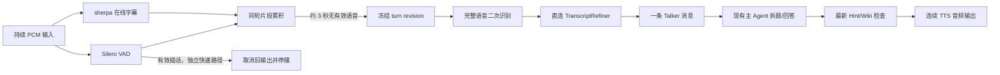

## Context

这是已实现实时通话的修复，不是把录音上传重新包装成通话。现有主干持续收发 PCM，但 ASR endpoint 直接 submit，浏览器 RMS 直接 cancel，导致声学分段、业务分轮与打断混在一起；大写英文直接进入主 Agent。具体证据和外部来源见 [research.md](research.md)。

规格已由用户批准并实施，实际验证与调整见 [implementation-status.md](implementation-status.md)。先前批准的 Hint/Wiki 最终检查、撤回和紧凑图标布局继续适用。

## Goals / Non-Goals

**Goals:** 短停顿不断句；约三秒无有效语音后形成一个输入；可靠插话时及时停播；英文自然大小写与有依据的识别纠错；校正直连且不会占用主 Agent 长链路。

**Non-Goals:** 复刻 Codex/豆包未公开内部算法、改造 PSTN/WebRTC、重新设计 UI、提高 LLM 权限、新建审批/评测平台。低风险展示变化不要求编写镜像测试；只保留少量分轮、取消和校正回归检查与实听。

## Decisions

### D1. 一个通话具有输入和输出两套独立状态

新增每通话 `TurnAssembler`，不以 session-wide `call.status` 同时表示两条流。输入状态为 `idle → collecting ↔ waiting_pause → finalizing → refining → committed`；输出仍为 listening/thinking/speaking，用户采集可以与 AI 播放并行。

三秒是**最后一段有效语音结束后的停顿**，不是每三秒提交、也不是最少说满三秒。一个词的问候也可以形成一轮；一句含多问仍是一个 Talker 气泡，主 Agent 再拆分问题。

### D2. VAD 负责停顿计时，ASR endpoint 只负责内部拼接

- Silero ONNX 16kHz/512 samples，每个通话独立 recurrent state。浏览器继续请求 AEC、noiseSuppression；RMS 仅显示音量。
- 初始建议参数：speech threshold=0.6、退出阈值=0.35、开启语音最短96ms、前置音频320ms。均为待实听调优的默认方案，不是准确率保证。
- `turn_end_silence_ms=3000`，从 VAD 最后一帧有效语音的音频时间戳起算；任何新确认语音重置静音窗口。静音3秒内不建消息、不拆题、不检索 Wiki。
- ASR 自身0.65秒/18秒 endpoint 输出 `segment_final`，交由 assembler 保留顺序；partial 是同一 segment 的替换修订，不是不断 append。只有稳定 segment 才累加，不能把最后一个片段误当整轮。
- 3秒条件满足时先排空已收到、时间范围在该轮内的 ASR 工作，再封存 turn 音频范围及 raw revision；计时器与新音频由同一 per-call 串行输入队列裁定。
- 网络不送包不等于静音。仅连续有效 PCM 证明的静音计入3秒；断流进入连接恢复，不提交残缺输入。静音控制暂停或丢弃未提交轮次并明确提示，不能靠补零伪造用户说完。
- ASR 内部按时长重置时继续保留同一个 turn。单轮缓冲初始上限60秒；达到上限明确请求用户短暂停顿，保留已采集内容，停止扩大缓冲，不静默截断后自动回答。更长语音作为后续按块落盘优化。

### D3. 打断不等待三秒，也不经过校正/主 Agent

服务端输出 `speech_started` 和 `interruption_confirmed`，替代浏览器 RMS `speech_start` 的直接取消权。

拟定有效插话：当前正在生成/播放，服务端确认持续人声≥300ms，并获得新的可辨识词；若ASR暂时未产出词但持续有效人声≥800ms，也让出话语权。单纯音量峰值、短噪声、旧 partial、自己的输出回声不构成有效证据；启用 AEC 并用实听检验回声，不声称 VAD 能鉴别声源。

未确认候选继续收音，不改输出 epoch、不修改历史、不额外发 LLM 请求。短“嗯/uh”且未构成持续插话不取消；用户明确说“stop”等短指令，可在已有有效人声/新词证据后立即停播。确认后沿用 epoch、取消任务、丢弃播放队列；不自动续播已取消尾句。这里先不增加复杂的暂停后断点续播机制。

Hinter 停止/纠正、人工撤回与挂断是显式控制，继续立即处理，不等待 VAD、三秒、二次ASR或文本校正。已听到的音频仍不能收回。

### D4. 用完整语音二次识别处理准确率，用 Refiner 处理文字形式

在线 sherpa 用于字幕和初始声学片段；二次识别使用预热共享的 faster-whisper `small.en`、CPU/int8、`language="en"`、`task="transcribe"`、beam_size=5，输入为内存音频数组，无需浏览器上传文件。词时间戳和 log probability/no-speech 信息作为质量信号；它们不是校准后的置信度。

可在静音≥800ms时启动一次可废弃的本地二次识别；3000ms之前无论结果是否返回都不提交。用户恢复说话后递增 revision 并丢弃旧预结果，不能每帧重解码。封存后若同一 revision 的结果已就绪直接使用；否则最多再等待1500ms。未就绪则保留 online raw 与 degraded 状态，避免无限等待；模型未加载完成期间不能阻塞媒体与控制事件。

最终是否默认启用 `small.en`，按目标机器几段实听录音的准确性与速度决定。若不能满足可用性，明确显示该环节未启用/降级，不能把只修大小写称为已解决 ASR 识别错误。

### D5. TranscriptRefiner 是独立的固定任务 subagent

是应用内专用组件，**不是主 Agent 再发一次工具调用，也不是每轮临时创建进程**。

1. 启动时从现有模型配置解析专用 `CALL_TRANSCRIPT_MODEL`，未指定时选当前启用的非思考模型并固定；预建客户端，不申请新凭证。
2. `TranscriptRefiner.refine(input) → structured result` 直连该客户端，一次调用、temperature=0、关闭 thinking、max_retries=0；整个调用默认4500ms截止，可配置。初始1500ms预算因当前模型服务少量实测约1～4秒且频繁触发降级而调整。禁止复用当前 `ModelRouter.run` 遍历35秒超时模型池的策略。
3. 输入仅含本轮 online raw、final ASR、音频/分词质量信号，以及最多2条已提交 Talker 原话的有限上下文。没有 Wiki 检索、Hinter 私有提示、工具、长期记忆或主 Agent 推理。
4. 正常输出自然英文句子，保留 `I`、人名/地名有依据的大小写及 `DAU/API/ID` 等缩写；不使用整串 lower/title case。不翻译成中文，不替用户回答，不为口语补造事实。
5. 允许标点/大小写、明确重复和明确自我纠正；数字、ID、单位、日期、否定词及问题范围不能无证据改动。识别通道对 fifteen/fifty 等关键内容分歧时输出 unclear spans，而不是任选一个。
6. 校正失败/超时只做本地格式降级，保留原始内容和未校正标记；无法可靠理解的内容进入澄清，不自动回答一个猜测的问题。普通可靠原话可以走现有主流程，不能因格式服务失败把整场通话卡死。

示例：`CAN YOU EXPLAIN DAU AND API LIMITS` → `Can you explain DAU and API limits?`；`FIFTEEN NO FIFTY ACCOUNTS` 可按明确自我纠正保留 fifty；音频两个识别结果对金额存在分歧时不能借 Wiki/常识替用户选数值。

### D6. 封存与提交分开，校正结果不能覆盖后续说话

三秒满足后为音频范围冻结 `turn_id/revision`，此时还没有正式聊天气泡；界面只有可更新的临时字幕与“整理中”。Refiner 完成后原子提交一条 completed Talker 消息，并派发一次主 Agent。

若用户在校正完成前继续说话，且前一轮尚未 commit：将续说并入同一 turn、递增 revision、取消旧 refine，重新等待三秒；迟到结果不能提交。单次用户最终轮次只接受最新 revision 的一次校正结果，废弃尝试不进入历史。若在 commit 后继续，则开启下一轮，不修改已提交原话；输出 epoch 拦截过时回答。

封存至commit期间 Hint 可更新；校正不重跑也不读 Hint，主 Agent 和最终 Wiki 检查必须读取当时最新有效约束。

### D7. UI 和数据：实时是传输行为，不是每帧新增气泡

延续三个图标按钮。通话区仅一个临时字幕槽，区分“正在听 / 等待说完 / 整理中”；partial 可以展示低成本的临时句首大小写，但不得冒充最终校正文本。正式气泡使用 corrected text；原始ASR保留用于Hinter查看和排障，不增加默认展开的大卡片，不逐token持久写整份session。

消息关联原PCM/音频范围、raw transcript、final ASR、correction status/model/revision、unclear spans。音频回听为原声，非“校正后的音频”。正式问句、风险分类和最近五题回查都建立在最终 committed turn 后；withdrawn 投影须同步隐藏新增的转写字段，避免从 provenance 恢复撤回内容。

协议详见 [contracts.md](contracts.md)。旧 `review_chat` 上传/手动确认不接入三秒缓冲。输出维持“完整短候选经 Hint/Wiki 检查，再分句TTS并流式播放”，不得为了看起来流式就提前播未经校验的 token。

### D8. 延迟与最小验证

分开记录 `last_voiced_sample → turn_frozen`（约3000ms，有意等待）、`final_asr_ms`、`refiner_ms`、`turn_committed → first_audio`、`confirmed_interruption → playback_stopped`。最终ASR封存后额外等待1500ms、校正默认4500ms是超时预算，不是实测P95。整体首音耗时包含三秒，不能继续宣称原语音末尾起算P50≤1.5秒。

功能验证只需少量代表性实听/回放：2秒停顿续说合并、3秒提交单条、噪声不取消/有效插话停播、大小写与DAU/ID、关键数字分歧澄清、迟到校正不串轮；以及一条旧录音上传回归。不建设百轮压测或额外题库作为本轮门禁。

## Risks / Trade-offs

- [三秒等待有感延迟] → 明确呈现持续聆听；预热模型并利用停顿期做可废弃的本地二次识别。未经用户改变策略，不偷偷缩回0.65秒。
- [LLM 文字校正会猜错] → 用完整音频二次识别提供证据，关键内容分歧澄清，保留 raw 与修订；不把流畅程度当正确性。
- [CPU竞争和原生推理不可取消] → 共享预热模型、限制并发、结果按 revision 作废；控制事件不持有推理锁，不无限排队。
- [外放回声与噪声仍可能被当人声] → AEC + Silero + 持续语音/新词证据，保留耳机建议；必要时后续专门增强回声处理，不承诺任意环境零误判。
- [新元数据泄漏撤回内容] → 统一角色投影/音频410/Wiki tombstone，对新增 raw/final/refined 字段执行同一撤回隐藏规则。

## Migration Plan

先加 TurnAssembler 和独立元数据，再接 VAD/分轮，接二次识别和直连 Refiner，最后前端事件适配与少量实听。新call启用新协议；已在进行的通话保留原版本至挂断，不在半轮切换事件语义。旧消息没有转写元数据时仍显示原text；不批量AI重写历史、Wiki或撤回记录。

参数/模型可配置回退，旧录音上传不变；回退需明确恢复的是旧通话行为，不能把已关闭的三秒/校正功能显示为启用。规格完成不代表运行时修复完成。

## Open Questions

没有需要用户再拍板的产品问题：三秒、直连校正和保留功能已由本轮请求确定。剩余只有实施期用真实目标机器实听调整VAD阈值、确认small.en耗时的技术工作，不作为增加审批的理由。
