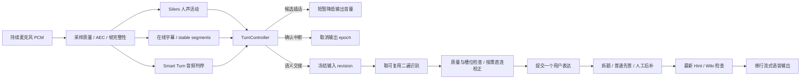

## Context

本设计把“像电话聊天一样自然”作为结果要求；三秒和每轮校正是之前为解决问题选择的手段，可以修订。保留连续双向音频、分段字幕、二遍识别、两种主活动状态、多问调度、人工提示与最终检查，逐步改进交接和声学输入。源码观察、只读探针及一手资料在 [research.md](research.md)。P0已依本设计实施，实际取值、验证和剩余边界见[实施记录](implementation-status.md)。

## Goals / Non-Goals

**Goals:** 完整短问及时接话，长句思考不被抢话，短确认不被吞，附和不切断AI，明显stop能快速让出，术语和关键槽位更可靠，实际等待可解释且可恢复。

**Non-Goals:** 训练或复刻Seeduplex、重做整个业务Agent、增加第二路语音、自动开摄像头、解读所有环境声、承诺任意多人混响场景零误打断、建设审批平台或百轮题库。

## Decisions

### D1. 同时维护两条流和一个交接控制器

`TurnAssembler`继续负责PCM范围、片段合并与revision；新增`TurnController`负责接话/等待/插话的裁决，不把所有职责继续堆进receive_audio。Smart Turn是结束发言预测器，不直接调用主Agent或TTS。UI仍只有倾听/思考两个主活动状态，candidate_end、ducking等是内部状态。

### D2. 三秒改为有界回退，正常使用动态判停

初始窗口如下，已用于实现；具体性能以回放记录为准，不作普遍保证：

| 情况 | 决策与建议等待 |
| --- | --- |
| 音频预测完整、字幕较稳定，无未完槽位 | 最后有效语音后约450–900ms形成交接候选，结合个人停顿习惯在范围内调整 |
| 音频预测不确定，转写还在变化 | 通常等900–3000ms，允许有限次重判 |
| “my ID is…”、连接词未完、自我纠正中、明确还有后文 | 不因三秒到点交给回答Agent，可等到约6000ms后转为简短澄清；不猜缺失内容 |
| 用户明确说“let me think / wait, let me finish” | 维持倾听直到继续或显式控制；不在六秒到点强制回答 |
| 模型未准备/超时/语言不支持 | 明确降级到当前三秒静音策略；已知未完关键槽位仍先澄清，不能说“智能判断已结束” |

450ms不是所有情况强制结束。独立短回应“Yes”“No”在需要确认时可以构成完整表达；“and…/because…”等是延后证据，不是对所有词尾一刀切的标点规则。识别加上的问号不代表真实语气已经结束。

停顿习惯只保存当前call的有界统计，不持久生成声音身份档案；初始样本不足不激进调整。检测器一次只运行一个任务，每个静音区间最多约四次预测，新有效语音使旧revision失效，不能每32ms推理一次。默认候选等待推理预算150ms、硬截止200ms；超时不阻塞媒体线程。

Smart Turn adapter使用当前轮末尾最多8秒16k单声道PCM，保留完整ASR片段记录和整个用户表达，**8秒模型窗口不是截断用户消息的上限**。固定模型版本与预处理，用官方实现对齐特征，不假设现有WhisperModel可以直接充当判停模型。不引入整个Pipecat/LiveKit会话运行时。

### D3. 先感知有人想说，再判断要不要取消

`InterruptionDecision`独立于结束发言预测，消费当前有效人声、稳定词片段、AI是否正在说、是否正期待确认、可用的回声证据。

| 决策 | 行为 |
| --- | --- |
| 明确stop/wait、纠正、真实新请求 | 不要求凑够多词；尽快确认并取消输出epoch，保留新输入 |
| AI讲解时短yeah/uh-huh等附和 | 不取消、不新增业务问答；需要确认答案时的yes/no例外 |
| 有语音但尚不确定意图 | 候选阶段轻度降低AI音量，最多约500ms内更新判定；不立即丢弃当前答复 |
| 有充分证据的回声/非交互噪声 | 忽略交互触发，但保留质量计数；不能只因文本与AI相似就判为回声 |

P0采用显式短指令、附和和预期回答等少量上下文规则，结合持续人声证据；不宣称规则能可靠分辨所有旁人聊天。取消现有“持续800ms便无条件确认插话”的语义；时长是证据而非意图。不能把所有短语都当附和，也不能把所有长人声都当打断。

候选降音只作用于播放GainNode，不停止采集、不推进epoch、不改历史；误候选结束后恢复原音量，当前答复继续。确认后清空播放队列和旧帧，旧native任务迟到也不能发布。不自动重播已被正式撤销的尾句。Hinter停止、封禁、撤回和挂断保留立即执行的显式控制，不经过分类器。

### D4. 改善输入质量，再让文字更漂亮

保留sherpa实时字幕与完整语音二遍识别。使用稳定前缀/可修订尾部更新同一字幕槽，最终识别可以局部回改，不逐字生成消息或全段反复闪烁。确认自然英文大小写、标点、API/DAU等缩写与原ID大小写。

增加独立`RecognitionContext`：小规模产品词汇、专名及其明确发音，来源于应用的公开词汇或Hinter明确标为可供识别使用的术语。不是从全部Hint/Wiki自动摘取内容。业务数字、查询答案、封禁原则和私有指令不进入识别词表；术语只偏置同音候选，不能作为必须出现的文本。

在线sherpa热词需核验现有transducer与modified_beam_search的成本，验证无偏置时的普通英文不变差；若不合适，可先只接二遍ASR。二遍上下文参数以已安装faster-whisper版本支持为准。热词表建议最多约50项、1000字符，按call版本冻结；更新只影响后续输入，不篡改历史。

`TranscriptRefiner`保留专用直线路由和无工具/Wiki的边界，改成**按需**：

- 最终ASR自然可读、关键槽位有依据且一致、质量信号无异常：局部规则格式检查后直通，标记`verified_passthrough`，不能谎称经过LLM纠错。
- 确有可修复重复、格式或依据充分的词汇问题：直接调用专用agent，建议预算约800–1200ms，仍受总剩余预算限制。若服务本身更慢，以明确超时降级保留原话，不又遍历模型池。
- 数字/ID/否定等关键内容冲突、缺失或音频被破坏：优先局部英文澄清，不让普通语言模型凭常识改成一个流畅的假问题。final ASR更流畅或分数更高本身不足以证明金额正确。

直通资格不能仅以“全大写已转小写”决定；质量信号不作未经校准的置信率。无论识别和校正用了什么路径，最终业务回答仍按最新Hint/Wiki校验。识别上下文版本和原始结果保留给Hinter排障，撤回投影同步隐藏。

### D5. 延迟预算从“十秒没卡死”走向正常接话

保留软件处理十秒硬上限；从**实际选择语义交接并冻结输入**开始，不要求再补等三秒。提前进行的本地二遍识别和端点预测可以复用，已继续说话则作废。临时字幕期间不触发公开检索、业务工具、主Agent回答或Wiki事实写入。

先优化固定等待、重复识别、非必要校正和已知常识误分流；不通过删除最后Wiki检查或提前播放未经校验token提速。单句候选保持短，普通题能答先答、人工题独立挂起；保持之前的补答队列和依赖关系。

拟定体验目标：清楚完整短问的交接等待通常不超过约1秒；暖机、无查询的普通短问，语音末尾到首段音频发送争取≤4.5秒，十秒作为异常上限。达不到时按ASR/校正/主模型/校验/TTS拆解，不只移动计时起点。客户端实际播放需另测；冷启动、人工等待、用户继续讲话和排队播放单列。这些是优化目标，不是豆包同等延迟承诺或已测P95。

### D6. 音频工程有可观察依据

采集后读取实际track.getSettings与AudioContext.sampleRate；验证AEC、降噪、AGC的实际配置，16k输出重采样对44.1/48k输入使用经过验证的抗混叠处理。不能把低音量硬裁掉当降噪，以免吞掉短词和否定。

下一媒体协议增加音频seq/sample_start/sample_count等完整性信息；如有丢帧、乱序、积压，不能把缺失样本记作静音，也不能把破碎音频伪装成高置信输入。控制事件继续优先，不每帧读写整个session。具体接口见 [contracts.md](contracts.md)。

P0支持浏览器AEC和单个近场说话者，提供外放回声、持续噪声的可见降级与静音/挂断恢复。普通降噪不能消除另一人的清晰语音，单通道PCM也没有方向信息；不要为了“锁定用户”自动建立永久声纹。

P1若实听仍被旁人声破坏，再通过独立adapter对照云端流式ASR/RTC主说话人抑制。临时声音聚焦需明确启用与数据路径，仅本call使用；未启用或不支持时不显示“主说话人已锁定”。不把这一外部依赖作为本地P0的前置条件。

### D7. 紧凑反馈不等于更多面板

仍用三个入口图标和原字幕区。倾听状态允许“还在听，你可以继续”；真正交接后才进入思考。需要澄清时只问不清楚的数字/名词，不让用户重述整段五问。检测器降级只在原位置说明一次，后台诊断保留原因；不向Talker显示模型内部概率、私有提示或复杂开关。

明确短确认与长表达都能自然结束，不要求用户说固定口令或点击发送。临时降音失败可恢复；挂断、静音和Hinter提示继续可操作。旧录音上传及已开始的通话不在中途切换语义。

## Alternatives and rollout

P0：先接本地判停adapter、插话候选/附和和关键槽位规则、二遍上下文与按需校正、帧完整性和端到端测量。仍用现有FastAPI/PCM、现有业务调度与Wiki检查。新call绑定`endpoint_mode=adaptive`，检测器故障退回`fixed_silence`，用户能看到降级，兼容开关保留现有行为。

P1：在同一小组真人音频上对照更强的流式ASR和可选说话人聚焦；只有发现声学识别/源分离仍是瓶颈才启用。需要音频出网时明确配置服务和凭证，不暗用现有文本模型配置自动发送原声。

P2：视觉上下文和原生S2S另立规格，必须证明能遵守双输入角色、最新Wiki检查和输出撤销；本次不提前扩大范围。

## Minimal verification

沿用现有回归，仅为新控制器的边界/迟到结果/候选恢复增加少量检查；不新建评测平台。选择下列约十段短录音，先用当前版本留一次基线，再用新版本回放并实听；其中噪声、重叠、外放必须包含真人麦克风，不只TTS合成。

| 体验场景 | 观察结果 |
| --- | --- |
| 简单完整短问 | 无固定三秒尾等，记录真实语音末尾至可听首音 |
| 句中停顿两秒后继续 | 同一表达，不在半句抢答 |
| 未说完的ID/金额停三到五秒 | 不猜值；续说合并或只澄清关键槽位 |
| 自我纠正 fifteen, no, fifty | 最终意图保留，不能按早期片段查询 |
| AI讲解中的uh-huh/yeah | 不硬取消；需要确认时的yes/no仍被接收 |
| 简短stop/wait与完整新请求 | 快速降音/停止，采集不中断，不等三秒 |
| 键盘/风扇/自己的扬声器声音 | 不把普通噪声当新问题；回声不足时明确记录限制 |
| 背景他人说话及重叠 | 单独记录真实误触发，不声称P0已有主说话人隔离 |
| 专名、缩写和关键槽位 | 词汇有帮助，无“热词补进未说出的事实” |
| 五问混合、Hinter中途封禁或补充 | 普通先答、人工后补，最新约束与撤回继续有效 |

记录切错/多等/误打断/漏掉明确stop、关键槽位是否正确、各阶段耗时和降级原因；样本少就报告具体次数，不推导P95。没有真人录音的场景标未验证，不用新增大量测试题代替实际体验。无需等待任何云服务开户才能完成P0。
