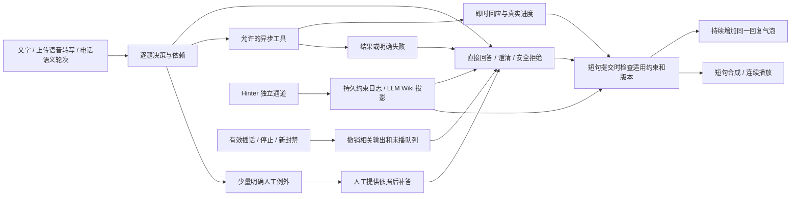

# 自然交流与异步 Hint：设计总览

日期：2026-10-22。状态：**四份变更的核心功能已实施**，见[实施记录](response-flow-implementation.md)。

目标：把“问题 → 审核 → 整答 → 语音”改为“问题 → 使用最新 Wiki 构建回答 → 按完整短句持续输出”。Hinter 在独立通道修改约束、补充依据、停止或撤回，不需要一直盯盘放行。

## 四份独立变更

| 顺序 | OpenSpec | 负责范围 | 不承担的职责 |
| --- | --- | --- | --- |
| A | [默认自动回答与少量例外](changes/default-auto-response/proposal.md) | 文本、上传语音、电话统一自动答；细分澄清、拒绝、缺能力和真正人工等待 | Wiki 持久化、音频协议 |
| B | [Hinter / Wiki 异步约束](changes/async-hinter-wiki/proposal.md) | 跨模式约束生效、版本一致性、生成中更新、回查与撤回 | 决定何时接话、TTS |
| C | [通话即时回应](changes/conversational-call-feedback/proposal.md) | 先出声回应、诚实进度、慢任务与后续补答 | 用口头禅代替结果、强制每题先说收到 |
| D | [文本与语音增量输出](changes/streaming-response-speech/proposal.md) | 真正 LLM 流、短句提交、TTS 增量、全程打断、播放确认 | 重做已有 ASR / 自适应判停 |

A 和 B 是共同语义基础；D 使用 A 的逐题裁决、B 的版本快照。C 使用 D 的同一输出调度器，也可以先在当前短句播放路径中落地反馈，随后迁移。最终交付必须连通四者，不能只把“待审核”改成“处理中”。

## 统一产品决定

1. 三种入口默认自动回答。`review_chat` 旧名称不再代表必须人工审核，后续可内部迁移为 `message_chat`，不得让协议改名成为实施前置。
2. “问题记录”“通知 Hinter”“等待调用结果”“等待 Talker 澄清”“必须人工提供信息”是不同状态。只有最后一种或显式人工规则进入待人工列表。
3. 人生意义、普通新话题、轻微脏话、公开知识/公开检索、一般歧义不默认挂起。危害性协助自动拒绝或安全转向，不能靠 Hinter 放行。实际非公开指标/身份记录不能编造，也不能把它们发送公开搜索。
4. Hinter 已明确禁止的问题，后续直接遵守并给允许的边界回复，不能每次重新索要人工许可。明确标记 `require_human` 的少量规则才要求等待。
5. Wiki 从“每个整答末尾再调一次主模型做总审”改为“生成前读取、短句发布前检查、版本变化使旧结果失效”。保留约束验证，取消例行人工门禁及无差别整答串行 LLM 检查。
6. 电话中直接答案本身就算回应；慢查询先给自然短回应再继续处理。不会虚称已有工具、已启动查询、已通知真人或已拿到数据。
7. 字幕、问题入库、候选文本、已公开文本、已发送音频和实际已播音频分别记录。未说出的后半句不记成已告知。
8. 先复用本地 FastAPI / PCM / Kokoro 与现有状态控制；云双向 TTS 是可配置增强，不能成为无需新账号的 Demo 的硬依赖。

## 当前实现的冲突与替代边界

| 历史约定 | 本组设计的替代 |
| --- | --- |
| constitution I：消息必须批准 / 草稿确认；通话开放领域、数据默认等待 | A：默认自动，明确例外才等待；历史已存在草稿不自动发布 |
| constitution VI：AI 文本完成后启动 TTS | D：完整短句提交即进入合成，整答完成只用于收尾与归档 |
| add-realtime-call-mode 的完整候选 Wiki Gate | B + D：按适用约束验证短句，检查完整已提交前缀与当前候选，发布点检验最新 revision |
| call-conversation-scheduling 的超时转 held | A + C：超时是能力/服务失败，回应并结束或转可取消后台补答，不自动制造人工待办 |
| improve-natural-voice-interaction D5“不得删除最后 Wiki 检查” | 保留最新 Wiki 验证，但单位由整答变为可安全独立公开的短句；验证策略见 B |

旧变更还没有归档成 `openspec/specs` 基线，因此四份 change 用新增 capability 描述本次增量；以上替代表明确记录重叠。历史实现状态不回写为新功能已完成。实施 A 时同步修订 constitution I/V，实施 D 时修订 VI；本轮仅记录拟修订内容。

## 实施切片与最少验证

先做 B 的统一约束读取和持久版本，再做 A 的跨入口默认自动与精简策略；随后打通 D 的“首个短句在模型结束前可见且可听”，接入 C 的快速回应/慢任务补答。每个切片保持可用，不建设新审批平台、微服务或大题库。

验证围绕真实问题：三种入口普通问题无点击可答；一段五问仅明确例外挂起；生成中 Hint 生效；长答案未完成即可播放；思考/合成/播放均可打断；最新五题自动封禁回查和任意历史气泡手动撤回不退化。少量可重复录音和真实实听足够，详细任务在各 change 内。

仅以实际版本号迁移和单个输出所有权控制新旧代码。默认交付行为就是自动回答，不能遗留一个默认关闭的 AI 开关让功能看似上线。短期兼容仅用于读历史状态与旧客户端，不建设永久双流程配置矩阵。

调研与代码依据：[response-flow-research.md](response-flow-research.md)。
