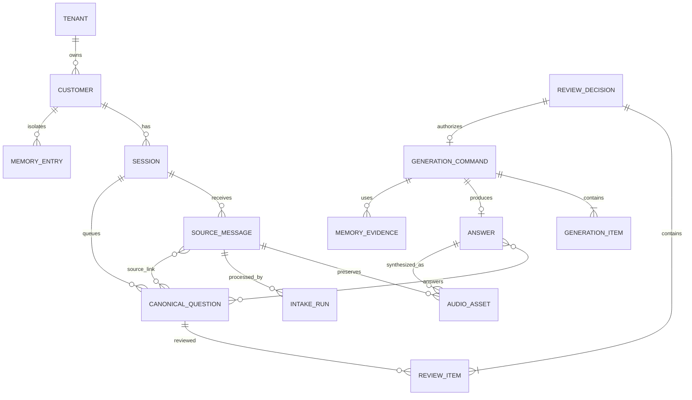

# 数据模型：双通道实时语音 Agent

## 1. 通用规则

- UUIDv7（或等价时序 UUID）作为主键；时间为 UTC `timestamptz`。
- 所有表含 `tenant_id`；客户数据含 `customer_id`；会话内数据含 `session_id`。
- repository 方法必须接收非空 `TenantCustomerScope`；组合外键/索引防止跨 scope 关联。
- `version` 用于乐观并发；敏感正文支持应用层 envelope encryption。

## 2. 实体

### Tenant / Customer / Actor

- `Tenant(id, name, status)`
- `Customer(id, tenant_id, external_ref, display_name, status, created_at)`，唯一 `(tenant_id, id)`。
- `Actor(id, tenant_id, subject, role[talker|hinter|admin], status)`；role 来自认证映射。

### Session

`id, tenant_id, customer_id, status[active|ended], language, next_sequence, created_at, ended_at, version`

不变量：所有子实体 scope 与 Session 完全一致。`next_sequence` 在事件事务中递增。

### SourceMessage

`id, tenant_id, customer_id, session_id, actor_id, input_mode[voice|text], raw_text?, final_transcript?, transcript_language?, transcript_version, status, created_at, version`

- text 输入的 raw_text 即可 Intake；voice 必须 `transcript_final`。
- 同一 transcript version 最多一个成功 IntakeRun。

### AudioAsset

`id, tenant_id, customer_id, session_id, source_message_id?, answer_id?, kind[source|tts], object_key, content_type, duration_ms?, checksum, status, provider_ref?, created_at, expires_at?`

`source_message_id` 与 `answer_id` 二选一；object_key 永不直接出现在客户端 DTO。

### IntakeRun

`id, ...scope, source_message_id, transcript_version, status[queued|running|completed|no_question|failed], model_ref, schema_version, error_code?, created_at, completed_at`

唯一 `(source_message_id, transcript_version)`；structured output schema 明确禁止 answer 字段。

### CanonicalQuestion

`id, ...scope, display_no, normalized_text, status[pending_review|approved|rejected|generating|answered|failed], duplicate_count, dedupe_group_id?, dedupe_confidence?, created_at, version`

唯一 `(session_id, display_no)`。低置信重复保留独立项。

### QuestionSourceLink

`question_id, source_message_id, transcript_version, span_start, span_end, raw_fragment_hash`

支持多对多追溯，不在普通 Talker DTO 暴露内部 hash。

### ReviewDecision / ReviewItem

- `ReviewDecision(id, ...scope, reviewer_id, action[approve|reject], private_hint_ciphertext?, review_notes_ciphertext?, created_at, idempotency_key)`
- `ReviewItem(review_id, question_id, question_version, ordinal)`

批准前锁定并校验所有 item；批次全有或全无。Talker 仅获得 `human_reviewed: true`。

### GenerationCommand / GenerationItem

- `GenerationCommand(id, ...scope, review_id, scope_hash, status, fence_token, lease_owner?, lease_expires_at?, request_hash, error_code?, created_at, updated_at, version)`
- `GenerationItem(generation_id, question_id, reviewed_version, ordinal)`

active 状态：`queued, leased, running, text_completed, tts_pending`。部分唯一索引：`UNIQUE(scope_hash) WHERE status IN (...)`。`fence_token` 单调递增。

### Answer

`id, ...scope, generation_id, public_text, language, status[text_completed|completed|failed], created_at, completed_at, version`

GenerationCommand 至多一个逻辑 Answer。Answer 可关联多个问题；join 表 `AnswerQuestion(answer_id, question_id)`。

### MemoryEntry

`id, tenant_id, customer_id, session_id?, scope[turn|short|long], content_ciphertext, content_hash, valid_from, valid_until?, status, priority, metadata_json, created_at, version`

- turn 必须有 session_id；short/long 可为空。
- 查询必须 `tenant_id AND customer_id`，turn 额外 `session_id`。
- `MemoryEvidence(generation_id, memory_entry_id, scope, rank, used, content_snapshot_hash)` 仅 Hinter/内部可见。

### DomainEvent / Outbox

`DomainEvent(id[event_id], ...scope, session_id, sequence, aggregate_type, aggregate_id, event_type, internal_payload, occurred_at)`，唯一 `(session_id, sequence)`。

`Outbox(id, event_id, topic, status, attempts, available_at, locked_at)`；至少一次消费，consumer 以 event_id 幂等。

### IdempotencyRecord

`tenant_id, actor_id, endpoint, key, request_hash, response_status, response_body_ref, resource_id, expires_at`，组合唯一；同 key 不同 hash 返回冲突。

## 3. 关系图

## 4. 状态转换约束

- SourceMessage 只有 text ready 或 voice transcript_final 可创建 IntakeRun。
- IntakeRun completed/no_question 不可再次运行；失败重试复用逻辑 run identity 并记录 attempt。
- CanonicalQuestion 进入 approved 必须有对应 approve ReviewItem；进入 generating 必须有关联 active GenerationItem。
- GenerationCommand 创建必须引用 approve ReviewDecision；完成更新必须匹配当前 fence_token。
- Answer `text_completed` 同事务写 `tts.requested` outbox；TTS failed 不删除/降级文本。

## 5. 投影视图

### Talker public

Session 基础状态；SourceMessage public text/final transcript/audio playback URL；Question ID/text/public status/duplicate count；Answer public_text、public question IDs、TTS audio 状态/URL、`human_reviewed`。禁止 hint/reviewer/review notes/memory evidence/内部 IDs/prompt/tool trace/provider detail。

### Hinter private

包含 Talker public 字段，并增加 ReviewDecision、hint、reviewer、版本冲突信息、分层 MemoryEvidence 与内部可行动错误；仍不默认暴露加密值、密钥或供应商凭据。
