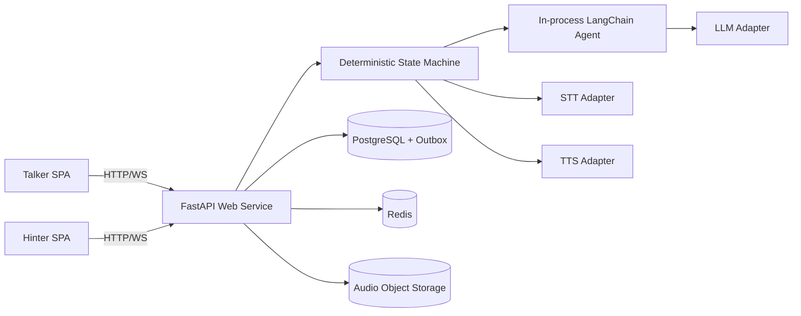
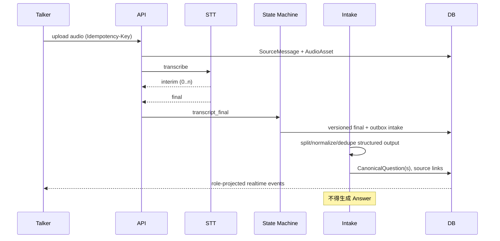
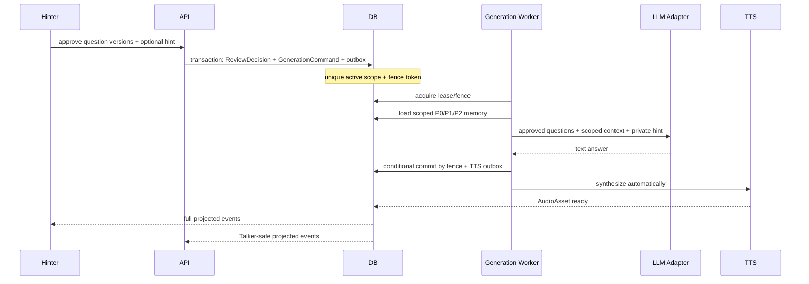

# 实现计划：双通道实时语音 Agent（一期）

> **Demo 实现状态（2026-10-22）**：当前代码已完成可运行的单服务 Demo，实际部署使用 React/Vite、FastAPI、SQLite、Markdown Wiki、LangChain 和 STT/TTS adapters；不是本计划原定的 PostgreSQL/Redis/OIDC 生产拓扑。已实现草稿确认发布、Talker/Hinter 字段投影、英文 TTS、模型主备回退和 Docker；详细清单见 [implementation-status.md](implementation-status.md)。

## 1. 技术上下文

| 项 | 决策 |
|---|---|
| 前端 | React 19、TypeScript、Vite、Tailwind；单页面双角色视图 |
| 后端 | Python 3.12、FastAPI/Pydantic、单一可部署 Web 服务 |
| Agent | 自研确定性控制面 + LangChain 模型/structured output/prompt/tool abstraction |
| 数据 | PostgreSQL 事实源；Redis presence/cache/pubsub/lease；对象存储音频 |
| 实时 | WebSocket 主通道，SSE 只读降级，HTTP 承载命令 |
| 外部能力 | STT/TTS/LLM provider adapters |
| 明确不用 | DSH、LangGraph、一期多微服务 |

## 2. 系统上下文



信任边界：浏览器不可信；供应商返回不可信；FastAPI 认证、scope enforcement、状态机和 role projection 是安全边界。PostgreSQL 为唯一事实源。

## 3. 组件职责

- **SPA**：录音/上传、interim 展示、问题审核 UI、音频控制、事件去重与游标恢复；不承担授权或门禁。
- **API/Command handlers**：认证、请求校验、Idempotency-Key、事务调用，不直接编排模型。
- **Role projector**：以显式 DTO 白名单分别投影 Talker/Hinter；用于 HTTP 和发布事件。
- **State machine**：唯一状态转换入口，校验 Review Gate、版本、lease/fence、重试与补偿。
- **Intake service**：调用 LangChain structured output，验证“不含回答”的 schema，持久化 CanonicalQuestion 与 source link。
- **Generation service**：根据批准集合装配上下文、调用 LLM、条件提交 Answer。
- **Memory service**：强制 tenant/customer scope，按 turn/short/long 分层检索、预算和冲突规则装配。
- **Audio service**：对象存储、STT final、TTS command/asset、短签 URL。
- **Realtime gateway**：WS/SSE 订阅、按角色投影、sequence 补发、resync。
- **Adapters**：统一供应商超时、错误分类、重试与 metrics。
- **Outbox worker（同进程独立 worker entrypoint）**：可靠执行 Intake/Generation/TTS，不构成独立微服务。

## 4. 关键时序

### 4.1 输入到审核



### 4.2 审核、生成和 TTS



## 5. 状态机

### SourceMessage

`draft_upload → uploaded → transcribing → transcript_final → intake_pending → intake_complete`；失败分支 `transcription_failed`（可重试）与 `intake_failed`。interim 不改变持久化业务阶段。

### CanonicalQuestion

`pending_review → approved → generating → answered`；`pending_review → rejected`；`approved/generating → failed_retryable → generating`。只有 Review Gate 可进入 approved，只有持有当前 fence 的 worker 可推进 generating/answered。

### GenerationCommand

`queued → leased → running → text_completed → tts_pending → completed`；失败为 `failed_retryable/failed_terminal/cancelled`。active 集合为 `queued|leased|running|text_completed|tts_pending`。lease 超时允许新 token 接管，旧 token 的写入条件失败。

### AudioAsset

Talker 原音频：`uploading → ready`；AI 音频：`queued → synthesizing → ready|failed`。AI 音频失败不回滚 Answer。

## 6. 事务、幂等与并发

1. 写请求先以 `(tenant_id, actor_id, endpoint, idempotency_key)` 查命令记录，并校验 request hash。
2. 批量审核锁定全部问题，校验 tenant/customer/session/version/status；任一失败整批回滚。
3. 同事务写 ReviewDecision、GenerationCommand、question transition、DomainEvent/outbox。
4. `generation_scope_hash` 由排序后的 review item/version 构成；部分唯一索引限制 active scope。
5. worker 获得递增 `fence_token`；所有完成/失败更新均含 `WHERE fence_token=:token AND status IN (...)`。
6. provider callback 以 provider_event_id 去重。outbox 至少一次投递，consumer 幂等。

## 7. 角色投影

内部模型不直接序列化。`TalkerSessionView/TalkerQuestionView/TalkerAnswerView` 只包含公开字段；`Hinter*View` 才包含 review、hint、memory evidence。事件先转换为角色事件 schema 再写连接，禁止发送后前端过滤。投影测试对字段名和 canary 值双重检查。

## 8. 目录规划（后续实现）

```text
frontend/                    # React/Vite UI 原型
├── src/
├── package.json
└── vite.config.ts
backend/
├── app/main.py
├── app/api/                 # sessions/messages/questions/reviews/answers/memory/audio/realtime
├── app/domain/              # entities, transitions, invariants, errors
├── app/application/         # commands, intake, generation, memory, projection
├── app/adapters/            # postgres, redis, object store, stt, tts, llm
├── app/workers/             # same-service outbox consumers
└── tests/{unit,integration,contract,security,concurrency}/
specs/001-dual-channel-voice-agent/
```

## 9. 测试策略

- **单元**：状态转换表、Intake schema 禁止 answer、记忆优先级、投影白名单、错误分类。
- **属性测试**：任意事件序列都不能在无 approved review 时产生 generation；旧 fence 永不成功提交。
- **集成**：PostgreSQL 事务/唯一索引/outbox，Redis lease 丢失，音频授权。
- **并发**：20+ 审核竞争、lease 接管、重复 callback、乱序事件。
- **契约**：OpenAPI request/response、WS/SSE event schema、adapter fake。
- **安全**：tenant/customer canary、IDOR、Talker 字段/值泄漏、hint prompt injection。
- **E2E**：语音 final→队列→批量审核→Answer→自动 TTS；autoplay 降级；断线恢复。
- **前端**：build、关键组件交互、event reducer 幂等、音频状态机。

## 10. 安全与隐私

- OIDC/JWT 鉴权；服务端角色和 scope；对象 URL 短签且复核 scope。
- SQL repository 要求 Scope 对象，禁止可选 tenant/customer 参数；数据库可叠加 RLS。
- hint/音频/transcript/记忆按敏感数据处理；静态/传输加密、保留期、删除任务与审计。
- 日志仅记录 hash/长度/ID；trace baggage 不放正文；管理操作最小权限。
- Prompt 将 hint 标记为不可信内容，tools 固定 allowlist 且不能访问任意 customer。

## 11. 可观测性与恢复

- trace spans：upload、stt、intake、review_wait、generation、memory_query、llm、tts、project、publish。
- metrics 见 research；告警覆盖审核绕过尝试、fence 冲突异常增长、投影 canary、事件 lag。
- 快照 + sequence event log 恢复连接；PostgreSQL 备份/PITR；Redis 丢失只影响缓存/吞吐，不影响事实。

## 12. Constitution Check

| 原则 | 计划证据 |
|---|---|
| 审核先于生成 | ReviewDecision FK、事务门禁、属性测试 |
| 确定性控制面 | 自研状态机；LangChain 限定职责 |
| 隔离优先 | Scope repository、组合索引、canary 测试 |
| 后端角色投影 | 双 DTO + HTTP/事件统一 projector |
| 单 active generation | 唯一索引 + lease + fence |
| 音频可追溯/降级 | 原音频、final、TTS outbox、autoplay fallback |
| 可验证规格 | FR/NFR→tasks→测试追踪 |
